  

> [!WARNING]
> **No affiliation with loradataset.com.** That website is not operated, endorsed, or supported by the LoRA Dataset Studio team. Any payments made to that service do not support this project. Use this repository and the links provided here to find our official downloads and community channels.

# LoRA Dataset Studio V2

Free local LoRA training studio: turn one reference photo or a whole image folder into a captioned LoRA dataset, train character, style and concept LoRAs for Krea 2, FLUX.1, FLUX.2 Klein, Qwen-Image 2.1, Z-Image, SDXL and Anima, then pick the best checkpoint side by side. LDS runs on your machine in one browser tab and uses [ai-toolkit](https://github.com/ostris/ai-toolkit) for training and [ComfyUI](https://github.com/comfyanonymous/ComfyUI) for local generation and checkpoint testing, without a node graph to wire.

[Install](#setup--install) · [Documentation](docs/README.md) · [Plugins](#plugins) · [Releases](https://github.com/perfectgf/lora-dataset-studio/releases) · [Discord](https://discord.gg/j6hnJBFtXE)

> [!IMPORTANT]
> **New LDS versions reach Patreon members first.** Each new version is available early to [Patreon](https://www.patreon.com/c/Loraperfectgf) members (**LDS Member**), then to everyone; exclusive plugins stay members-only. The version you have stays free and keeps working.

The current core and public plugins are free under the [PolyForm Noncommercial license](LICENSE), and running them needs no account; optional usage statistics are off by default. External APIs and rented GPUs have their own charges. A Patreon membership is needed for new versions and exclusive plugins, not to keep using the version you have.

<table>
  <tr>
    <td width="50%" align="center"><a href="docs/screenshots/generate/generate-variations.png">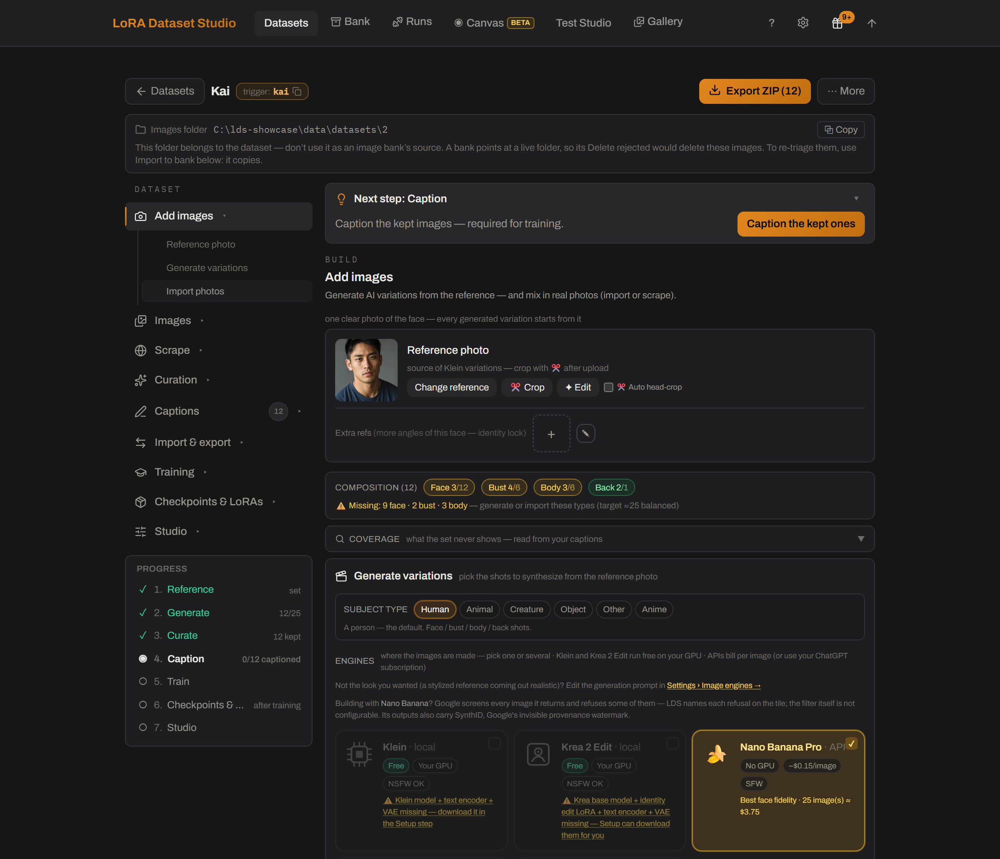</a> Generation engines</td>
    <td width="50%" align="center"><a href="docs/screenshots/02-workspace.png">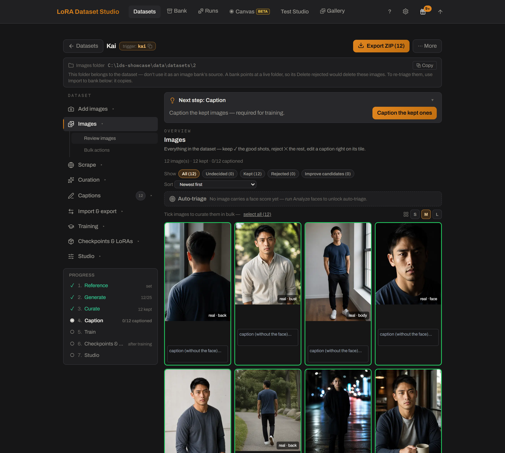</a> Dataset workspace</td>
  </tr>
</table>

A complete Character LoRA workflow in seven minutes:

https://github.com/user-attachments/assets/d51ff89c-34e9-41a9-b47d-08939a8c867b

People shown in the demo and screenshots are AI-generated.

## What it does

| Area | Capabilities |
|---|---|
| Datasets | Character, Concept and Style workflows; image and ZIP/folder import; subject-aware shot catalogs; local Klein and Krea 2 Edit generation; reference editing and exact retries |
| Image Bank | Review folders in place, score quality, group duplicates and people, search by text or similarity, and build balanced shortlists to promote into datasets |
| Curation | Keep/reject, crop, mirror, rotate, face similarity, composition checks, editable watermark masks, text detection and recoverable cleaning |
| Captioning | Local vision models or JoyCaption, family-appropriate prose or tags, appearance policies, bulk editing, targeted re-captioning and external image/`.txt` round trips |
| Local training | Guided ai-toolkit recipes for Z-Image, SDXL, Krea 2, FLUX.1, FLUX.2 Klein, Anima and Qwen-Image 2.1; queues, advanced settings, checkpoint continuation and experimental slider LoRAs |
| Review and testing | Generate with all seven image training families; fixed-seed checkpoint/strength comparisons, prompt batches, runs, logs, lineage, votes, rankings and a generated-image Gallery |
| Files | Standard training ZIPs and sidecars, backup/restore without API keys, ComfyUI deployment, configurable storage and Trash |

Dependencies vary by feature. Bank search ranks matches; it does not guarantee exclusions. Undo covers specific actions, and **Delete rejected** can remove source files after confirmation. Video and slider workflows are experimental. See the [feature reference](docs/guide/features.md), [requirements](docs/guide/requirements.md) and [known limitations](docs/guide/known-limitations.md) for the detailed behavior.

## Plugins

Install optional features from **Plugins → Store**, configure and prepare them in their own settings, and update them through **Plugins → Updates**. Several plugins can be installed together with one LDS restart. Each is independently installable; model downloads, hardware and provider credentials depend on the feature.

| Plugin | What it does | Main requirements |
|---|---|---|
| [API image engines](bundled/api_engines/) | Generate images with Gemini/Nano Banana, ChatGPT or OpenRouter; experimental ChatGPT subscription connection | Provider credentials; API usage is billed by the provider |
| [Camera angles](bundled/camera_angles/) | Create new viewpoints of Gallery or dataset images with controls for direction, height and distance | ComfyUI, Qwen-Image-Edit and Multiple-Angles LoRA |
| [Canvas](bundled/canvas/) | Arrange runs and checkpoints on a visual board, compare or blend LoRAs, generate images and export layouts | ComfyUI for generation; one model family per generation batch |
| [Cloud training](bundled/cloud_training/) | Train image or video models on rented GPUs, monitor runs, recover checkpoints and deliver full Krea 2 models | [vast.ai](https://cloud.vast.ai/?ref_id=683073) account and API key; Hugging Face access for applicable runs |
| [DLSS 5 Neural Rendering](bundled/dlss5/) | Improve a finished video's lighting and materials, compare with the original and export the result | Windows x86-64, NVIDIA driver, compatible model supplied by you and the prepared bridge |
| [Klein Improve](bundled/image_upscale/) | Re-render image detail with instructions, LoRA presets and finishing controls | ComfyUI and Klein models; appearance and color can change |
| [Live channels](bundled/live/) | Continuously render scripted H3 scenes and watch them in a browser or VLC | Compatible local ComfyUI, H3 weights and stream encoder; experimental |
| [Model tools](bundled/model_tools/) | Quantize full models to fp8 or merge weighted LoRAs into a base checkpoint | Python with PyTorch and output disk space; CPU processing, no GPU required |
| [Publish to Civitai](bundled/civitai_publish/) | Upload checkpoints and generated images to a model page | Civitai API key; checkpoints default to drafts, image posts default to publication |
| [Publish to Hugging Face](bundled/hf_publish/) | Export kept images, captions, metadata and a dataset card to the Hub | Write-enabled Hugging Face token; private repository by default and rights confirmation |
| [Resource monitor](bundled/resource_monitor/) | Show CPU, GPU, RAM, VRAM and temperatures, with guarded memory release | No model download |
| [SeedVR2](bundled/seedvr2/) | Restore and upscale images with high-resolution tiling and finishing controls | ComfyUI, SeedVR2 nodes and models; optional TTP nodes for tiling |
| [Video lane](bundled/video/) | Build video datasets from local files or web imports, curate shots, train LoRAs and test H3 generation, continuation and interpolation | Dependencies vary by task: PyAV/ffmpeg, ai-toolkit, ComfyUI and model weights; Video Bank remains beta |
| [Web scraping](bundled/scrape/) | Import selected images or clips from searches and supported gallery URLs into datasets or banks | Source-dependent credentials and permissions; Pexels requires explicit dataset/ML authorization |

API providers apply their own billing and content policies. Model licenses also apply, including MiniMax H3's territory restrictions; check the [video limits](docs/guide/features.md#video-bank-beta--first-release-read-the-limits) before using it. Plugin authors can start with the [SDK and package guide](docs/plugins/README.md).

## Screenshots

Click a screenshot to view it at full size.

<table>
  <tr>
    <td width="33%" align="center"><a href="docs/screenshots/bank/bank-overview.png">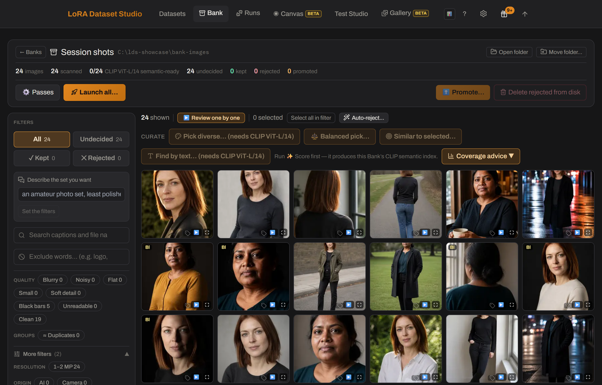</a> Image Bank</td>
    <td width="33%" align="center"><a href="docs/screenshots/bank/bank-analyze-and-overview.png">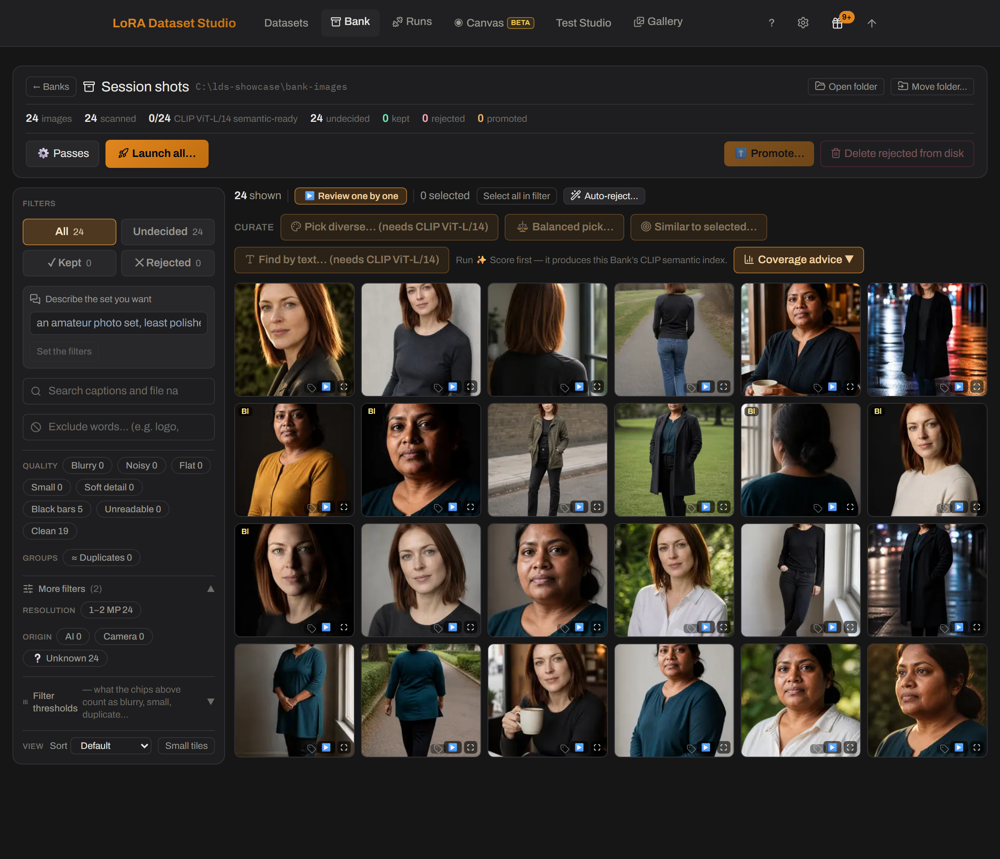</a> Analysis and coverage</td>
    <td width="33%" align="center"><a href="docs/screenshots/bank/bank-launch-all.png">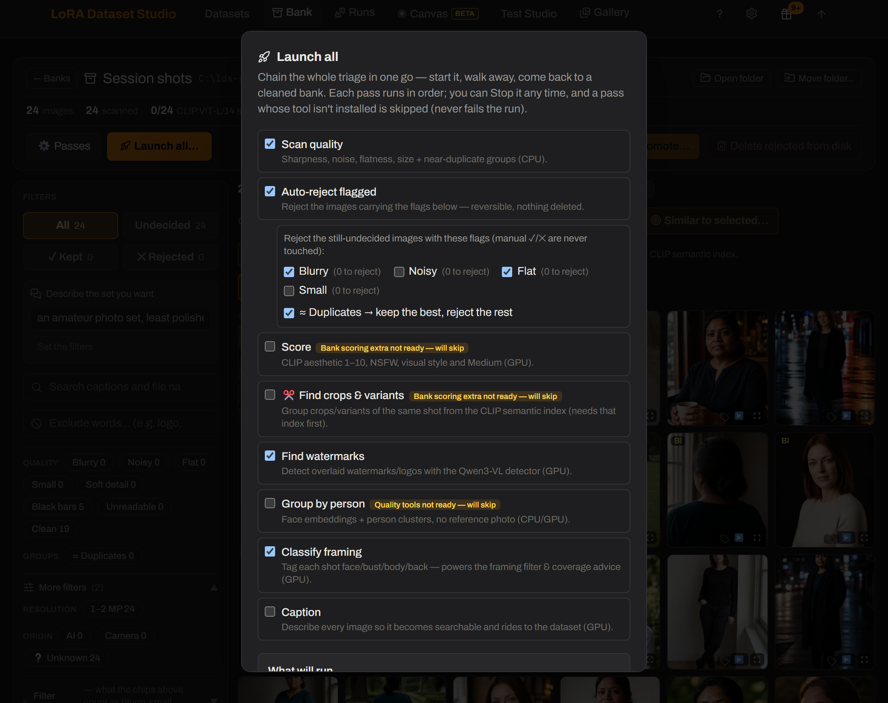</a> Batch analysis</td>
  </tr>
  <tr>
    <td width="33%" align="center"><a href="docs/screenshots/03-curate.png">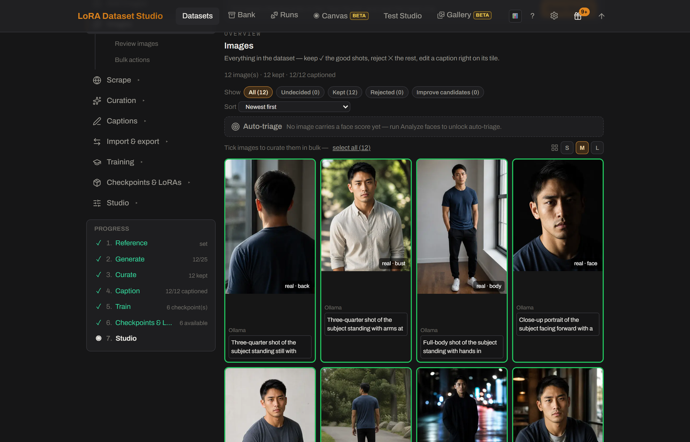</a> Dataset curation</td>
    <td width="33%" align="center"><a href="docs/screenshots/bank/find-text-launch.png">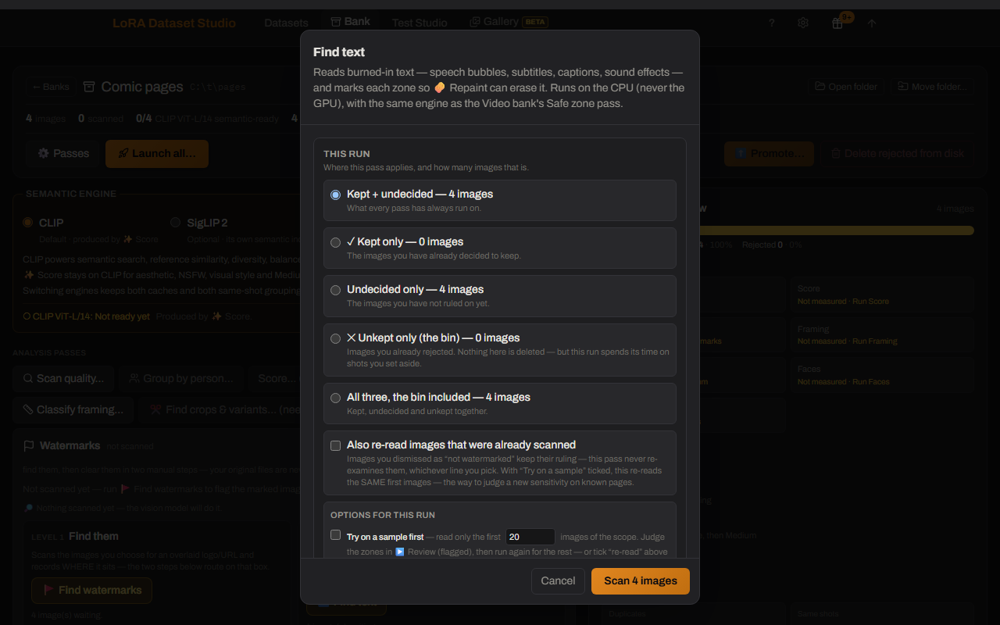</a> Text detection</td>
    <td width="33%" align="center"><a href="docs/screenshots/training/runs-hub.png">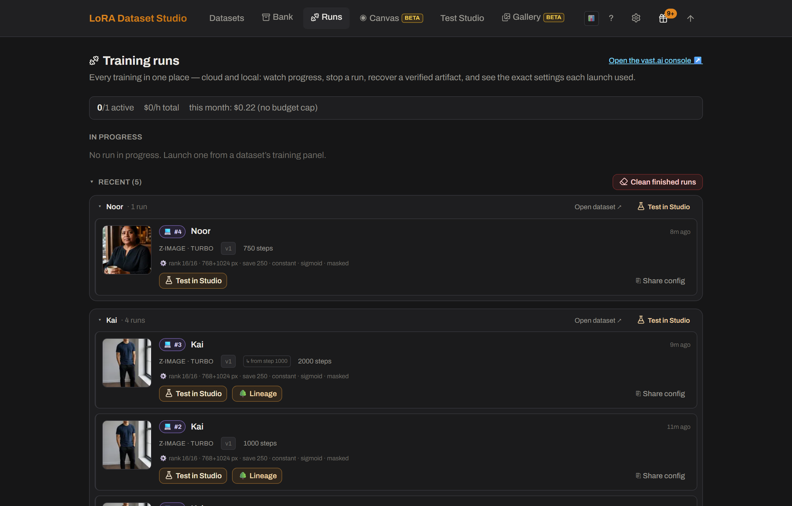</a> Training runs</td>
  </tr>
  <tr>
    <td width="33%" align="center"><a href="docs/screenshots/studio/studio-grid.png">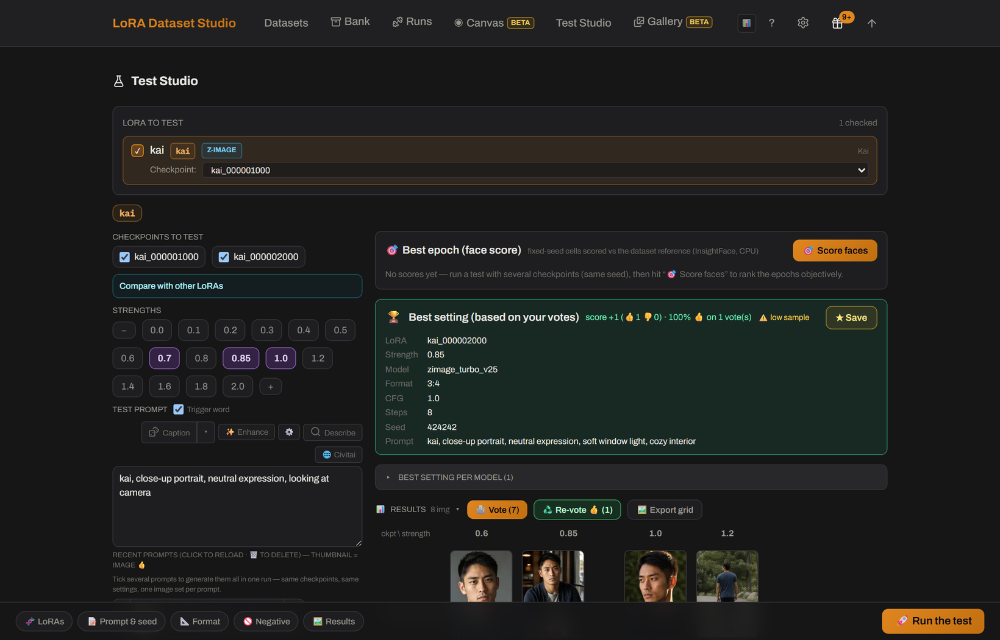</a> Checkpoint comparisons</td>
    <td width="33%" align="center"><a href="docs/screenshots/canvas/canvas-board.png">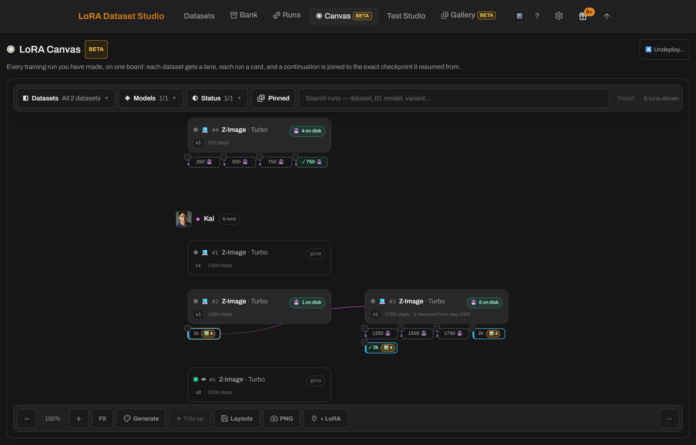</a> LoRA Canvas</td>
    <td width="33%" align="center"><a href="docs/screenshots/studio/civitai-prompt-browser.png">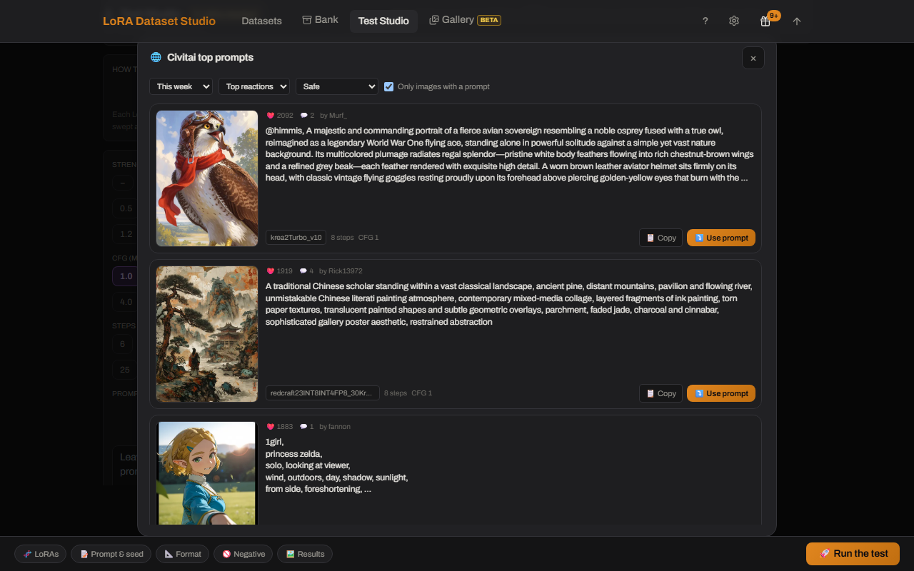</a> Civitai prompts</td>
  </tr>
  <tr>
    <td width="33%" align="center"><a href="docs/screenshots/release/camera-angles-picker.png">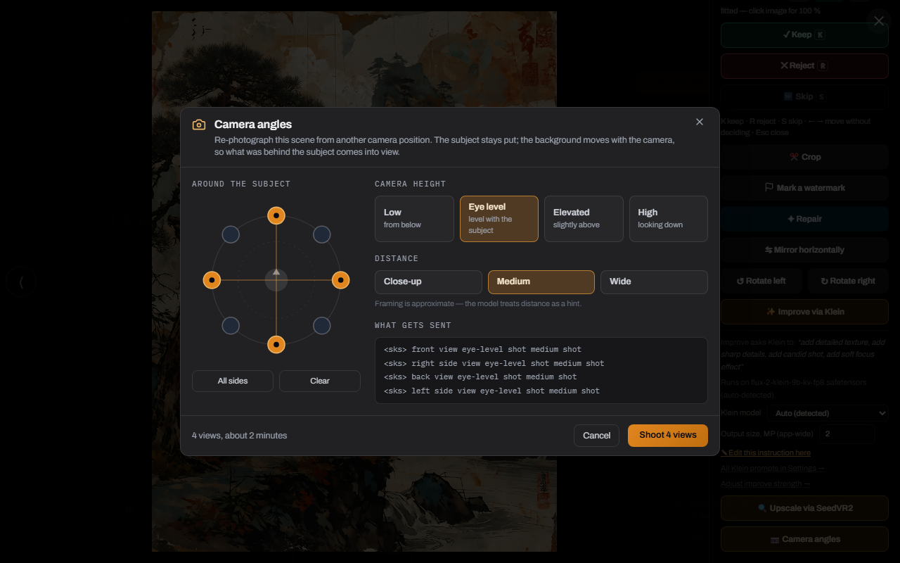</a> Camera angles</td>
    <td width="33%" align="center"><a href="docs/screenshots/video/video-studio-clips.png">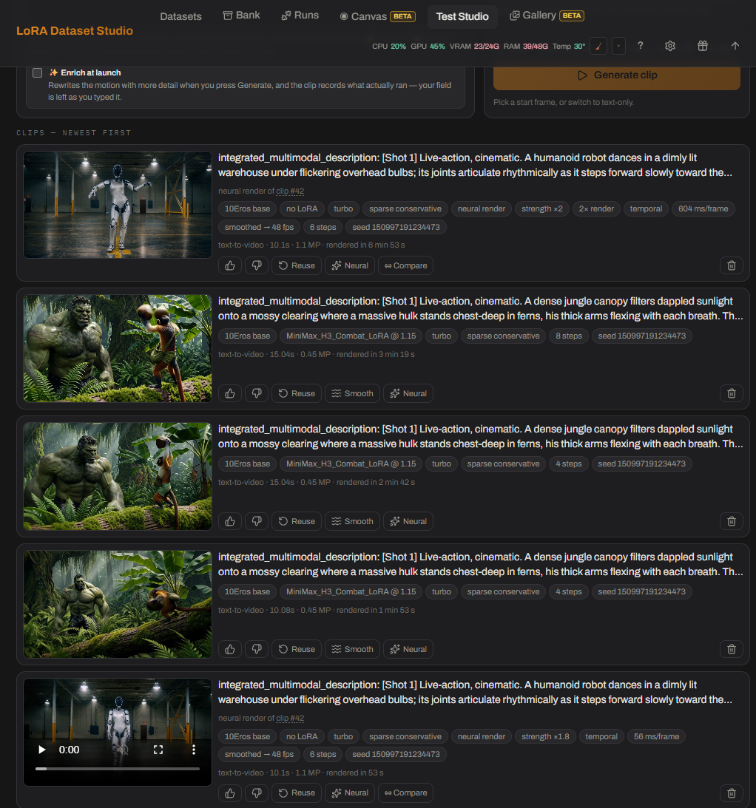</a> Video Test Studio</td>
    <td width="33%" align="center"><a href="docs/screenshots/video/dlss5-compare.png">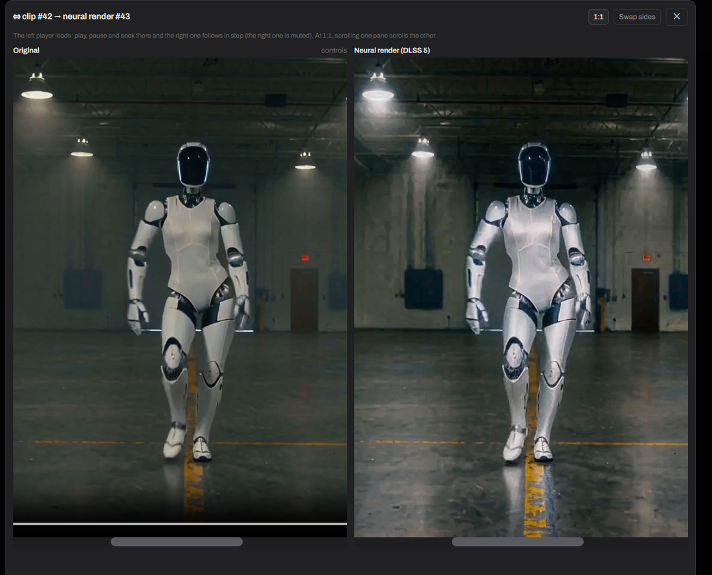</a> DLSS 5 comparison</td>
  </tr>
</table>

## Setup & install

**Windows:** download `LoRA-Dataset-Studio-windows.zip` from the [latest release](https://github.com/perfectgf/lora-dataset-studio/releases/latest), extract it into a new folder and run `start.bat`. The launcher prepares Python and opens LDS in your browser.

Complete **Setup**, then create a dataset or install the plugins you need. Importing, organizing and manually captioning images require no GPU or API key.

| Installation | Instructions |
|---|---|
| Git checkout or manual Python environment | [Native installation](docs/guide/installation.md#windows) |
| Docker with an existing or fresh ComfyUI | [Docker guide](docs/guide/docker.md) |
| Docker without a GPU | [API-only setup](docs/guide/installation.md#docker-without-a-gpu) |
| Pinokio | [One-click installation](docs/guide/installation.md#pinokio) |
| Rented RunPod GPU | [RunPod guide](docs/guide/runpod.md) |

**Updates:** new LDS versions reach Patreon members first, then everyone, and install from **Settings → Maintenance → Updates**. Git and Pinokio checkouts fast-forward to a verified release; ZIP installations swap in a verified archive and retain their datasets, media, settings and history. Docker installations from the Windows ZIP install them from the host with `update-docker.bat patreon`. Without a membership, the installed version keeps working; `v1` is frozen and old `main` installations must [migrate to V2](docs/guide/migrate-to-v2.md). Pinokio and Docker keep their own [update procedures](docs/guide/installation.md).

### Minimum requirements

The core runs without a GPU. Python 3.10–3.12 supports the local ML extras; the Windows launcher downloads Python 3.12 if needed. Local generation typically needs about 16 GB NVIDIA VRAM; training requirements depend on the family and settings. See the [hardware and dependency tables](docs/guide/requirements.md) before downloading models or renting a GPU.

## Documentation

- [Getting started](docs/guide/getting-started.md) and [end-to-end workflow](docs/guide/workflow.md)
- [Task instructions](docs/guide/using-the-app.md) and [dataset quality](docs/DATASET_GUIDE.md)
- [Settings, models and paths](docs/guide/settings-reference.md), [external tools and API keys](docs/guide/installation.md#external-tools)
- [Troubleshooting](docs/guide/troubleshooting.md) and [known limitations](docs/guide/known-limitations.md)

The [documentation index](docs/README.md) includes development and plugin references.

## LoRA training FAQ

These are the questions that come up most in LoRA training threads, with what LDS does about each. The [dataset guide](docs/DATASET_GUIDE.md) has the details.

### How do I train a consistent character LoRA from one or a few photos?

Create a **Character** dataset and set a reference photo. LDS proposes a shot catalog for the subject (face, bust, body and back framings from several angles) and generates the missing shots locally with Klein or Krea 2 Edit, which restages the reference while preserving identity. InsightFace similarity and score-based auto-triage help you reject shots where the face drifts, and the [Camera angles](bundled/camera_angles/) plugin adds new viewpoints. Your own photos work too: import them, then let [coverage](docs/DATASET_GUIDE.md#9-coverage--what-your-set-never-showed) name what the set never shows, such as profile views or a second outfit.

### How many images do I need to train a LoRA?

About 25 varied images make a balanced character LoRA, and they beat 60 near-duplicates. Minimums depend on the family: 12 for Z-Image, 15 for Krea 2, FLUX.1 and FLUX.2 Klein, 20 for SDXL. Balance face, bust, body and back shots, because a set of close-ups gives a LoRA that falls apart on full-body prompts; the composition meter on the dataset page tracks that balance. See [how many images, and which ones](docs/DATASET_GUIDE.md#2-how-many-images-and-which-ones).

### Tags or natural language captions? Where does the trigger word go?

Match the caption style to the family: natural-language prose for Krea 2, FLUX.1, FLUX.2 Klein and Z-Image, booru tags for SDXL, either for Anima. LDS writes captions in that style with JoyCaption or a local vision model and puts the trigger word at the start of every caption on export. Describe what should vary (place, light, outfit, pose) and leave out what should stick to the trigger: per-trait appearance policies decide whether hair, makeup or glasses are described. See [captions](docs/DATASET_GUIDE.md#3-captions--the-make-or-break-step).

### Which base model should I train my LoRA on?

Choose the family before captioning, because it sets the caption style, the image count and the settings. In short: Krea 2 has the highest realism ceiling, FLUX.1 the largest LoRA ecosystem, FLUX.2 Klein 4B trains on mid-range GPUs, Z-Image iterates fastest, SDXL suits booru-native checkpoints and Anima targets anime. Qwen-Image 2.1 is supported too. See the [family comparison](docs/DATASET_GUIDE.md#1-pick-your-model-family-first).

### What steps, rank and learning rate should I use?

Start from the guided recipe for your family: LDS fills in the ai-toolkit settings and scales steps with the dataset, about 120 per image for a character LoRA, kept between 1,500 and 3,500, because a fixed 3,000 overcooks small sets. Raise the rank (48 to 64) only for a hard identity and a bigger dataset; a high rank on 15 images memorizes them. Advanced options stay editable, and a run can continue from any saved epoch. See the [settings cheat-sheet](docs/DATASET_GUIDE.md#4-settings-cheat-sheet).

### Which LoRA trainer should I use? Do I need the command line?

LDS trains with [ai-toolkit](https://github.com/ostris/ai-toolkit). Once ai-toolkit is installed and set in **Settings → Local tools**, LDS writes the training config: pick a recipe and start the run from the browser, with the queue and logs on the runs page. Datasets also export as standard ZIPs with `.txt` caption files, so the same set can feed kohya_ss, OneTrainer or another trainer.

### How much VRAM do I need to train a LoRA?

Importing, sorting and manual captioning need no GPU. Auto-captioning takes about 8 GB of VRAM and local generation about 16 GB. LoRA training needs 16 GB or more for Z-Image and SDXL (quantized, low-VRAM mode), 16 to 24 GB for FLUX.2 Klein 4B (32 to 48 GB for 9B), 24 GB for Krea 2 at 1024 px (under 24 GB, train at 768 px only) and about 24 GB for FLUX.1 and Anima. Short on VRAM? The [Cloud training](bundled/cloud_training/) plugin trains supported families on rented [vast.ai](https://cloud.vast.ai/?ref_id=683073) GPUs, and LDS itself can run on a [RunPod GPU](docs/guide/runpod.md). See the [hardware tables](docs/guide/requirements.md).

### How do I pick the best epoch or checkpoint?

Open the run in Test Studio: it renders the checkpoints you pick at several strengths with the same seed and prompts, so the images differ only by checkpoint and strength. Vote and rank them, compare several LoRAs or stack them, and test several prompts in one launch. See [after training](docs/DATASET_GUIDE.md#6-after-training-pick-the-right-checkpoint).

### Can I train a style or concept LoRA?

Yes: **Style** and **Concept** datasets have their own workflows. Concept captions must be prose rather than booru tags, steps grow more slowly with the image count (about 475 × √n, from 2,000 to 12,000), and the guide explains how to [keep faces out of a concept](docs/DATASET_GUIDE.md#8-concept-loras-keeping-faces-out).

### Can I train a video LoRA (Wan 2.2, LTX-2, MiniMax H3)?

Experimentally, with the [Video lane](bundled/video/) plugin (beta). It cuts clips to the frame counts each model accepts (4n+1 for Wan, 8n+1 for LTX), measures silence and audio level, shows burned-in subtitles and letterbox bars before training, and trains with ai-toolkit locally or on a rented GPU. Eight targets are offered across Wan 2.1, Wan 2.2, LTX-2, LTX-2.3 and MiniMax H3, but only Wan 2.2 14B has been through a finished run so far, filling 24 GB with CPU offload.

### Do I need to know ComfyUI?

You need a ComfyUI install for local generation, not its node editor. LDS sends its own workflows for dataset shots, edits, upscaling and checkpoint tests, and Setup downloads the generation models. With Docker, the launcher can set up a fresh, isolated ComfyUI.

### How do I upscale or restore images locally?

Install [SeedVR2](bundled/seedvr2/) to restore and upscale with high-resolution tiling, or [Klein Improve](bundled/image_upscale/) to re-render detail from instructions (appearance and color can change). Both run on your local ComfyUI.

## Configuration & network access

Use **Settings** for normal configuration. Native installs bind to `127.0.0.1` by default. Read the [security policy](SECURITY.md#the-default-threat-model) before enabling network access; a protected connection also lets you use LDS from a phone or tablet.

Optional usage statistics are off by default. Update checks, requested model downloads, configured providers and scraping can contact external services. The [network and privacy guide](docs/guide/network-access.md) describes these connections, the data shared and public-access settings.

## Support the project

A [Patreon](https://www.patreon.com/c/Loraperfectgf) membership (LDS Member) funds development and includes new features, exclusive plugins and LDS updates. [GitHub Sponsors](https://github.com/sponsors/perfectgf) also supports development, API testing and rented test GPUs. Bug reports, contributions and sharing the project also help. For support, generate a diagnostic report under **Guide → Getting help**, then use [Discord](https://discord.gg/j6hnJBFtXE) or [GitHub issues](https://github.com/perfectgf/lora-dataset-studio/issues).

**Affiliate disclosure:** the project's [vast.ai links](https://cloud.vast.ai/?ref_id=683073) pay the project 3% of referred users' spending for the lifetime of their account, at no extra cost. Rentals use your own API key and are billed directly by vast.ai. This is separate from optional usage statistics.

## Legal & responsible use

Use material you have the rights and consent to train on. Non-consensual likeness use, impersonation, fraud, and sexual or exploitative content involving minors are prohibited. You remain responsible for datasets and outputs. See [responsible use](docs/responsible-use.md) for consent, privacy, copyright, platform terms and warranty details.

## Contributing

See [CONTRIBUTING.md](CONTRIBUTING.md) for development and pull requests, and the [Code of Conduct](CODE_OF_CONDUCT.md) for community rules. Report vulnerabilities privately as described in [SECURITY.md](SECURITY.md).

## License

[PolyForm Noncommercial 1.0.0](LICENSE). Noncommercial use is permitted; commercial use requires separate permission from the licensor.
