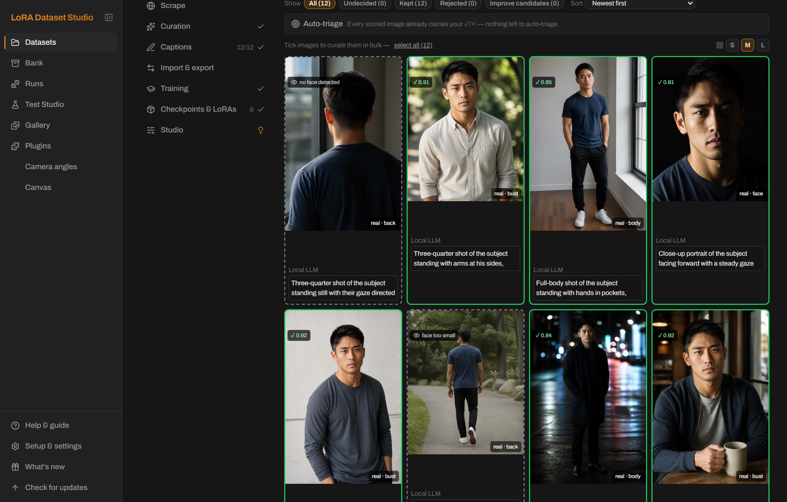
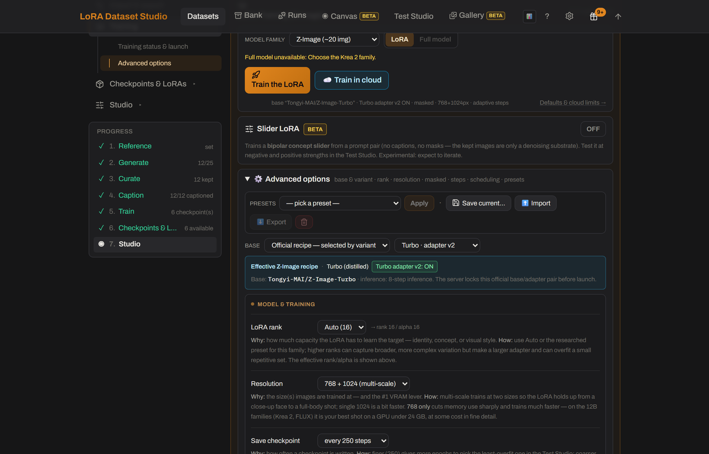
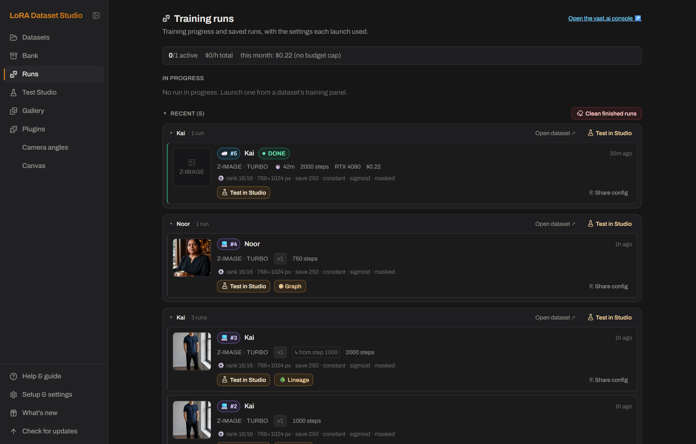
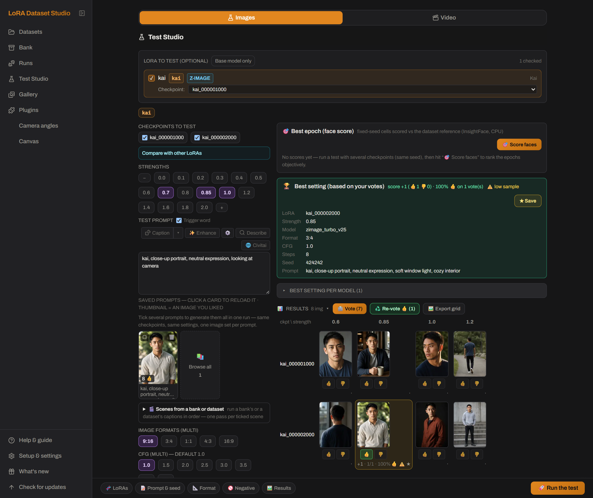

# The complete guide to training a LoRA
<!-- description: Train a LoRA from dataset to final checkpoint: images, captions, settings, testing and fixes, with the LDS feature for each step. -->

## How to use this guide

This guide follows LoRA training in the order you do it, from deciding what to train to publishing the file, and the advice holds whatever trainer you use. Each step explains what works and why, cites its sources as [n], then names the LoRA Dataset Studio (LDS) feature that handles the step, or says that LDS has none. If you already have a problem, find it in the table and go to the section that solves it.

| Your problem | Where to look |
|---|---|
| I am not sure whether I need a character, style or concept LoRA | [1. Decide what you are training](#1-decide-what-you-are-training) |
| I do not know which base model to train on | [2. Choose the base model family](#2-choose-the-base-model-family) |
| My GPU has 8 to 16 GB, or I have no GPU | [How much VRAM do you need?](#how-much-vram-do-you-need) |
| I only have one photo of the person | [I only have one photo of my subject](#i-only-have-one-photo-of-my-subject) |
| How many images do I need? | [How many images do you need?](#how-many-images-do-you-need) |
| My images are small, blurry or watermarked | [6. Clean the set](#6-clean-the-set) |
| Should I crop everything to a square? | [Should you crop to a square?](#should-you-crop-to-a-square) |
| Tags or full sentences in the captions? | [Tags or sentences?](#tags-or-sentences) |
| What should the captions leave out? | [What should a caption name, and what should it leave out?](#what-should-a-caption-name-and-what-should-it-leave-out) |
| Which rank, learning rate and step count? | [10. Training settings](#10-training-settings) |
| The loss curve tells me nothing | [Watch the samples, not the loss](#watch-the-samples-not-the-loss) |
| Which checkpoint should I keep? | [12. Pick the best checkpoint](#12-pick-the-best-checkpoint) |
| It does not look like the person | [The LoRA does not look like the subject](#the-lora-does-not-look-like-the-subject) |
| Results look burnt, waxy or oversaturated | [Overfit, burnt or oversaturated results](#overfit-burnt-or-oversaturated-results) |
| Every image has the same background or outfit | [Same pose, background or outfit in every image](#same-pose-background-or-outfit-in-every-image) |
| It only works at high strength, or breaks above 0.8 | [Works only at high strength, or breaks above 0.8](#works-only-at-high-strength-or-breaks-above-08) |
| Every face in the picture turns into my subject | [Other faces turn into your subject](#other-faces-turn-into-your-subject) |
| Watermarks or text show up in my outputs | [Text, watermarks or signatures in the output](#text-watermarks-or-signatures-in-the-output) |
| Out of memory, or the run crawls | [Out of memory](#out-of-memory) and [Slow run or idle GPU](#slow-run-or-idle-gpu) |
| Samples look fine but my ComfyUI renders differ | [Samples and the generation UI disagree](#samples-and-the-generation-ui-disagree) |
| The LoRA is almost right | [15. Iterate: continue, retrain, merge, sliders](#15-iterate-continue-retrain-merge-sliders) |
| I want to train a video LoRA | [16. Video LoRAs](#16-video-loras) |

## 1. Decide what you are training

### Character, style or concept?

Current guides sort LoRAs into a few types: a character or person, a style, a concept or object, and, for models that edit images, edit LoRAs trained on before and after pairs [1][3][4]. Each type keeps one thing constant across the images and lets everything else vary. That choice decides how you collect and caption the set.

| Type | What stays constant | What must vary | How captions treat it |
|---|---|---|---|
| Character | The identity (face, build, permanent marks) | Outfit, background, light, framing, expression | Name what varies, not the identity [1][5][6] |
| Style | The look (rendering, palette, line) | Subjects and layouts, as widely as possible | Describe the content only, never the look [2][3][6] |
| Concept or object | The thing or the action | Distance, angle, setting | Name everything that is not the concept, especially one-off items [5][49] |
| Slider | Nothing in particular | One trait, pushed in two directions | Two prompt poles instead of image captions |

Train one goal per LoRA. Krea states this rule explicitly (one character, one style or one product identity) [5], and the other guides are built the same way. Edit LoRAs are outside the scope of this page.

**In LDS:** the **Character / Concept / Style dataset kinds** change captioning, masking, readiness checks and training policies. Character uses a trigger word and person masks, Concept a trigger and optional face masks, Style no trigger. You can change the kind later in Dataset settings, and the confirmation explains which rules change and deletes no images. See [the workflow guide](guide/workflow.md#1-decide-what-you-are-teaching).

### What does a slider need?

A slider LoRA moves one trait up or down and is trained from two prompt poles. No source used here documents slider datasets, so this part rests on the LDS docs alone.

**In LDS:** **Slider LoRA (Beta)** trains a bipolar slider from a positive and a negative prompt pole, and Test Studio can sweep both sides. The floor is 4 images, with 12 recommended, and a slider with no prompt pair can never launch. Its step count is fixed and does not depend on the number of images. See [features](guide/features.md#train-compare-and-continue).

### One LoRA for several characters?

Putting two people into one file means balancing them, usually with repeats per subject folder and roughly equal image counts [23]. The evidence for this on current models is thin.

**In LDS:** no dedicated feature. Train one LoRA per subject, or export the set with **Export ZIP** and balance the subjects in a trainer that supports repeats.

### Video LoRAs

Video LoRAs follow the same logic with clips instead of stills, plus a frame-count rule for each model. Section [16. Video LoRAs](#16-video-loras) covers them.

**In LDS:** **New dataset → Video** (free plugin: Video lane) sets the target model, clip length and size, and **Add videos** encodes the imports to that target. See [video LoRA training](faq/video-lora-training.md#build-a-video-dataset).

### Limits

- Slider LoRA is Beta, and the README calls the video and slider workflows experimental.
- Face similarity does not run on Anime datasets.

## 2. Choose the base model family

### Which family should you train on?

Train on the model you will generate with. A LoRA loads only on the architecture it was trained for, so the family is the hardest decision to undo. ai-toolkit supports FLUX.1, FLUX.2 Klein, Qwen-Image, Z-Image, Anima, Krea 2, SDXL, Wan and LTX [7]. No source compared the families on quality with numbers, so choose by the ecosystem you already use and by your VRAM.

**In LDS:** the **Model-family selector (target model): Z-Image, SDXL, Krea 2, FLUX.1, FLUX.2 Klein, Anima, Qwen-Image 2.1** sets the caption style, the image floor and the training settings, and Z-Image is the default for new runs. Choose the family before you caption. See [which base model](faq/which-base-model-for-a-lora.md#the-families-side-by-side).

| Family | Caption style | Image floor | Local VRAM in the LDS docs | Cloud lane |
|---|---|---|---|---|
| Z-Image | Prose | 12 | 16 GB or more | Yes |
| SDXL | Booru tags | 20 | 16 GB or more | No |
| Krea 2 | Prose | 15 | 24 GB at 1024 px (768 only below that) | Yes |
| FLUX.1 | Prose | 15 | About 24 GB | No |
| FLUX.2 Klein | Prose | 15 | 4B: 16 to 24 GB. 9B: 32 to 48 GB | Yes |
| Anima | Tags or prose | 12 | About 10 GB, an estimate (2B model) | No |
| Qwen-Image 2.1 | Prose | 12 | Not measured in LDS (cloud: 32 GB or more) | Yes |

### Train on the base or on the distilled model?

Train on the undistilled base. Black Forest Labs (BFL) trains Klein LoRAs on the Base models because they keep the full training signal [1], and SimpleTuner reports poor results when training FLUX.1 schnell directly [19]. On Z-Image Turbo, a plain LoRA erodes the few-step behaviour: quality drops at 8 steps and CFG 1 and recovers only near 30 steps and CFG 2 [15]. Training adapters that loosen the distillation are a stopgap that their author calls a hack [11].

A LoRA trained on a base often works on its distilled sibling: the HF Klein post found the distilled 4-step model usually gives even better results [3]. Sizes do not cross, so a 4B LoRA goes with 4B [12].

**In LDS:** the **Base selector (Krea 2: Krea-2-Raw default, Turbo, or a local Krea 2 checkpoint)** trains on Raw by default, following the official advice to train on Raw and validate on Turbo, with Turbo as the fallback for drafts. Raw runs take hours by design. For Klein, the **Model size picker** offers 4B (default) and 9B. See [the dataset guide](DATASET_GUIDE.md#1-pick-your-model-family-first).

### Gated models and licences

Read the licence before you train. FLUX.2 Klein 4B Base is Apache 2.0, which lets you distribute what you train, and Klein 9B Base is under the FLUX Non-Commercial licence [1][3]. FLUX.1-dev is gated: you request access on Hugging Face and use a read token [7]. For the other families, check the model card.

**In LDS:** **Hugging Face token for gated bases**: accept the licence and set a Hugging Face token before the first run. FLUX.1-dev's first download is about 24 GB, and FLUX.1 trains locally only. See [the dataset guide](DATASET_GUIDE.md#1-pick-your-model-family-first).

### Limits

- SDXL, FLUX.1 and Anima have no cloud lane. Anima trains locally only for now.
- Qwen-Image 2.1 needs a current ai-toolkit with `qwen_image_2`. Its GPU memory has not been measured in LDS, and it has no reference-image editing or RGBA datasets.
- Families LDS does not train go to ai-toolkit directly, with the exported set ([features](guide/features.md#train-compare-and-continue)). MOSS-Image and H3 Image training are members-only (LDS Member).

## 3. Hardware and where to train

### How much VRAM do you need?

The size of the base model sets the floor and quantization moves it. Large models (Qwen-Image, Wan 14B, FLUX at 12B) need quantization or offloading to fit a 24 GB card [8][9][10][17].

| Setup | Reported need | Source |
|---|---|---|
| FLUX.1-dev, rank 16 | 30 GB or more unquantized, 18 GB int8, 13 GB int4, 9 GB NF4 | [19] |
| FLUX.2 Klein 4B Base | 12 GB VRAM and 32 GB system RAM | [1] |
| FLUX.2 Klein 9B Base | 22 GB VRAM and 64 GB system RAM | [1] |
| Qwen-Image at 1024 px, batch 1 | 42 GB plain, 30 GB fp8, 24 GB fp8 with 16 blocks swapped, 12 GB with 45 swapped | [17] |
| Wan 2.2 14B, ai-toolkit 24 GB example | 4-bit quantization, image-only training | [10] |

**In LDS:** the **Minimum requirements table** gives the smallest NVIDIA card for each task, from no GPU at all (import, sort, crop, manual captions, export) to about 24 GB. The floors come from a 24 GB reference card, and training below 16 GB has not been measured. See [minimum requirements](../README.md#minimum-requirements) and [VRAM by task](faq/lora-training-vram.md#vram-by-task).

### System RAM and disk

System RAM often runs out before VRAM. SimpleTuner plans about 50 GB while FLUX.1 is quantized at startup [19], Qwen-Image block swapping wants 64 GB [17], and Wan 2.2 offloading on Windows about 96 GB [18]. A LoRA file weighs 10 to 200 MB [1], but base weights start around 13 GB (Klein 4B in bf16) [3], and optimizer state for a resume adds more [21].

**In LDS:** the **Readiness panel / pre-launch checks** test disk and VRAM before a run. The requirements page enforces 10 GB or more of free disk per run and recommends 16 GB or more of system RAM, a figure it says was never measured ([hardware and platform](guide/requirements.md#hardware-and-platform)). **Settings › Storage** lists every folder with its size and moves the dataset root, cloud staging and checkpoint store to another drive ([keep control of the files](guide/features.md#keep-control-of-the-files)).

### How long does a run take, and what does it cost?

Resolution is the biggest time lever [19]. A Klein 4B LoRA took about 60 minutes on an RTX 4090 for 1,800 steps, about $0.50 rented [3], and BFL quotes 1 to 3 hours on consumer GPUs [1]. One Krea 2 recipe trained in about 15 minutes on a rented card but spent over an hour on setup and downloads [14], so downloads can cost more than the training. That rests on one source.

On RunPod (12 Nov 2026), an RTX 4090 rents from $0.34 per hour and an H100 PCIe from $1.99 [31], so a typical image LoRA costs a few dollars at most in GPU time.

**In LDS:** the **Cloud GPU picker (offer list)** (free plugin: Cloud training) shows each candidate GPU with its hourly rate, the estimated duration for this dataset and step count, and the estimated total. These are estimates, and Qwen-Image 2.1 has none yet. See [train in the cloud](guide/workflow.md#no-gpu-train-in-the-cloud).

### Local GPU or rented GPU?

A local card costs nothing per run and keeps your images at home. A rented card removes the VRAM ceiling but bills setup and download time too [14].

**In LDS:** **Cloud training (Train in cloud)** (free plugin: Cloud training) rents a [vast.ai](https://cloud.vast.ai/?ref_id=683073) GPU from the same launch flow, streams progress and checkpoints home and terminates the pods automatically, for Z-Image, Krea 2, FLUX.2 Klein and Qwen-Image 2.1. vast.ai is the only training provider: the **RunPod guide** runs the app on a pod, but not training ([no suitable GPU](faq/lora-training-vram.md#no-suitable-gpu)). See [train in the cloud](guide/workflow.md#no-gpu-train-in-the-cloud).

### How do you install the trainer?

You need one trainer that supports your family. ai-toolkit trains every family in this guide and documents its dataset format in its README [7].

**In LDS:** **Setup → LoRA training step → Install AI Toolkit** installs ai-toolkit in one click on a machine with an NVIDIA GPU, with the CUDA build of PyTorch, and checks that the GPU is visible. It needs about 8 GB free and is not offered in Docker ([install AI Toolkit](guide/settings-reference.md#install-ai-toolkit)). For an existing install, point **Settings → Local tools → ai-toolkit** at it. A plain `pip install torch` on Windows is CPU-only and trains on the CPU for hours without an error ([connect ai-toolkit](faq/which-lora-trainer.md#connect-ai-toolkit-once)).

### Limits

- Every LDS requirement figure was measured or enforced on the reference rig, an RTX 4090 with 24 GB, except the Anima estimate. Training below 16 GB has not been measured, and the system RAM figure was never measured.
- The memory panel's estimates are not measurements.
- Cloud durations and costs are estimates.
- The docs list NVIDIA cards only. Without one, **API-only mode** still runs API generation, import, curation, manual captions and export ([hardware and platform](guide/requirements.md#hardware-and-platform)).

## 4. Get the images

### Your own photos

Your own photos, licensed photos and public-domain works are the sources official guides recommend [3]. Fewer, better images beat a larger mediocre set [22][48][1]. One trainer-specific note: ai-toolkit lists JPG and PNG and flags WebP as a problem format [7].

**In LDS:** **Import** (drag and drop, **Import dataset (ZIP)** or **Import from folder**) accepts JPEG, PNG, WebP, BMP, HEIC and AVIF. Character datasets can auto-crop to the face while Concept and Style keep the frame, and merges skip perceptual duplicates. A plain drag and drop leaves the shot type unknown, so run **Classify framing** afterwards. See [fill it with images](guide/workflow.md#2-fill-it-with-images).

### I only have one photo of my subject

A LoRA trained on one image is rigid, so generate more images of the subject, curate them hard and train on the result [48]. Synthetic sets are used officially: BFL's style example is 27 generated images [2]. Two risks each rest on one source: a set generated with a weak first LoRA inherits its weak likeness [6], and a LoRA can learn a pipeline's artifacts [41].

**In LDS:** **Generate variations (reference photo + shot catalog)** proposes a shot catalog (53 shots for a human, 59 for an animal, 55 for anime) across face, bust, body and back, and generates the missing shots with each prompt wrapped in an identity guard. The shots come from local engines such as **Krea 2 Edit** and **Klein (local engine)** (about 16 GB of VRAM each) or from **Nano Banana Pro (Gemini), ChatGPT (`gpt-image-2`), OpenRouter** (free plugin: API image engines), billed by the provider. Generated shots are candidates, not guarantees. See [generate the missing shots](faq/character-lora-from-one-photo.md#generate-the-missing-shots).

### Scraping and importing in bulk

Gather broadly, then cull hard [49]. Mixing several sources reduces the pull of one artist's style [48]. None of the sources read for this guide discusses the licensing of scraped art.

**In LDS:** the **Web scraper** (free plugin: Web scraping) pulls from Reddit, Pexels or a URL, de-duplicates results and filters what enters a dataset (short side 768 px or more, ratio 3:1 or less). Licences are your responsibility ([web scraper](guide/workflow.md#the-built-in-web-scraper)). For a large folder, the **Image Bank (Folder or web scrape → bank)** inventories it in place without modifying, moving or renaming files, up to 200,000 images per bank ([image bank](guide/features.md#image-bank)).

### Frames from a video for an image LoRA

No source covers frame selection for still LoRAs. Treat frames like any other image: drop motion blur, compression damage and near-identical frames.

**In LDS:** no dedicated feature. Extract the stills with a video tool, then import them and apply the checks of section 6.

### Rights and consent

Train a real person only with their consent, and check each host's rules before you publish. Civitai removed all real-person likeness models and images on 22 May 2025, private individuals included, citing its payment partners and new laws [50]. That is one platform's rule, from its own announcement.

**In LDS:** the **Responsible use rules** ask for material you have rights and consent for, and prohibit non-consensual likeness, impersonation, fraud and content involving minors. You remain responsible for your datasets and outputs. See [legal and responsible use](../README.md#legal--responsible-use).

### Limits

- Generated shots are candidates. API engines carry provider billing and moderation, and the ChatGPT-subscription lane is experimental.
- Licences of scraped images are your responsibility.

## 5. Build variety and balance

### How many images do you need?

| Family or trainer | Type | Count given | Source |
|---|---|---|---|
| Krea 2, official | Any | Minimum 3 | [5] |
| Z-Image Turbo, one user | Character | 6 to 10 worked | [40] |
| SDXL, HF tests | Face | 6 to 10 | [22] |
| SDXL booru (NoobAI) | Character | About 30 | [48] |
| FLUX.2 Klein, BFL example | Style | 20 to 40 (15 to 20 for graphic styles) | [2] |
| Krea 2, one author's measured runs | Character | 40 to 80 | [6] |

The low end is disputed. Krea's minimum of 3 and a 6 to 10 image Z-Image report [5][40] stand against BFL's warning that fewer than 20 style images vary too little [2] and one author's runs, where backgrounds and outfits stuck to the character below about 40 images [6]. A small set can reproduce an identity but binds incidental details. Quality beats count: fewer, well-curated photos worked better than adding mediocre ones [22][48].

**In LDS:** the **Readiness panel / pre-launch checks** enforce a floor per family: 12 images for Z-Image, Anima and Qwen-Image 2.1, 15 for Krea 2, FLUX.1 and FLUX.2 Klein, 20 for SDXL and 4 for a slider. The docs recommend about 25 for a balanced character. **Continue anyway (readiness checkbox)** unlocks Train over quality blockers and records the launch as "acknowledged not-ready", which usually gives an overfit LoRA. See [minimums by family](faq/how-many-images-to-train-a-lora.md#minimums-by-model-family).

### Vary everything that is not the subject

Vary poses, angles, light and backgrounds, and mix close-ups with full scenes [1][5][22]. Anything that is constant across the set and never named in a caption is absorbed into the trigger, the same light in every shot for example [6]. A set of mostly plain backgrounds gives a plain-background bias [48], and a style set with one layout memorises the composition [5]. The best fix is more variety. The cheaper fix is to name the repeated element in the captions [6][5].

**In LDS:** **Coverage (panel under the Composition bar)** reports, per axis (camera view, camera height, lighting, setting, outfit, expression), what your captions never mention, and a click on a chip filters the grid to those images. It reads caption words, not pixels, does not parse negation and refuses to judge under five captions. See [coverage](DATASET_GUIDE.md#9-coverage--what-your-set-never-showed).

### Balance the framing

Framing ratios depend on the goal, and no source tests them. One SDXL guide puts about 50% face and upper body, 20% tight face and 30% other views [49]. A Z-Image face set used mostly tight face shots plus 3 to 5 upper-body frames [41]. Keep close-ups and full-body shots, and avoid distant subjects for identity work [22].

**In LDS:** the **Composition bar (composition meter)** counts face, bust, body and back shots against a target of 12/6/6/1, about 25 images. Only images with a shot type count, and a full bar does not prove variety. **Body fidelity mode** moves the target to 8/8/8/2 when body shape and tattoos are part of the identity, and **Classify framing (N)** sorts unknown images with a local vision model. See [balance the framing](faq/how-many-images-to-train-a-lora.md#balance-the-framing).

### Remove near-duplicates

Two shots of the same pose count twice and push the LoRA toward that pose. Keep only images that add something the set lacks [49][41].

**In LDS:** **Near-duplicate pairs in the pre-launch check (Reject this / Start anyway)** shows near-identical pairs side by side, with **Reject this** on each image, before the run starts. See [train](guide/workflow.md#6-train--guided-advanced-when-you-need-it).

### Limits

- Coverage reads caption words, not pixels, so it is advice only.
- The Composition bar target and Bank Balanced pick follow different rules by design.

## 6. Clean the set

### Is the resolution high enough?

BFL asks for source images of 1024 px or more [1], 1024 px on the long edge for style sets [3]. The SDXL-era floor is 768 px on one side [49]. SimpleTuner drops images under its minimum size [34].

**In LDS:** **Soft detail / Real-detail minimum** shows how much real detail an image holds, for example 2048 px stored but about 512 px of real detail. It is a shortlist, not a verdict, and it misses nearest-neighbour enlargements. See [is this image what it says](guide/using-the-app.md#is-this-image-really-what-it-says-it-is).

### Blur, noise, compression and duplicates

Drop soft or out-of-focus shots [49], prefer clean PNGs to JPGs with compression damage [48], and remove low-quality samples [1]. Keep the best copy of each duplicate (near-duplicates are covered in section 5).

**In LDS:** the **Quality and similarity passes (Image Bank)** flag blur, noise, flat frames, small or soft images and black bars, then group duplicates, crops and recompressions. The thresholds were calibrated on a real 7,316-image bank, and cases it cannot measure say "unsure". **Auto-reject by flag** turns a set of flags into one bulk rejection, undoable as one decision. Both need the Bank scoring extra. See [image bank](guide/features.md#image-bank).

### Watermarks, signatures and text

Remove watermarks and signatures [49][48][41]. Sources disagree on incidental text, sound effects and speech bubbles: one booru guide calls removing them optional because they rarely cause trouble [48], a forum thread says remove all text [41].

**In LDS:** **Watermark review (Find → Review → Clean)** lets local vision propose boxes, lets you edit the zones, then cleans by border crop, LaMa inpainting or a Klein whole-photo re-render, with a `.orig` backup. Klein re-renders everything, a mark the scan missed can survive, and GPU Docker has no inpainting ([scrub watermarks](guide/workflow.md#5-scrub-watermarks)). The optional **Watermark detector (Setup ▸ Quality tools)** caught 54 of 55 marked images and flagged 0 of 55 clean ones in the docs' test ([who decided](guide/using-the-app.md#who-decided-an-image-is-watermarked)). **Find text** sends burned-in lettering into the same mask ([image bank](guide/features.md#image-bank)).

### Other people in the frame

Keep other faces out of a face set [22]. Crop multi-character images and reference sheets down to the one subject [48]. Captioners also make more mistakes on images with several people [45].

**In LDS:** crop the extra people out in the **Curation grid** ([curate](guide/workflow.md#3-curate-down-to-the-keepers)). In a large pool, **Group by person** clusters images by their dominant face without a reference photo, once the Quality tools are installed from Setup ([triage a big folder](guide/using-the-app.md#the-image-bank-triage-a-big-folder)).

### Does every image still show the same identity?

Check that the subject's features are right in every image. One wrong eye colour is training noise [48].

**In LDS:** **Face similarity (InsightFace) + Auto-triage** scores every image against the reference photo, green from 0.50 and orange from 0.45 by default, and Auto-triage pre-marks images by score without touching the decisions you make later. It is refused on Anime datasets. **Compare with reference** shows the reference beside any image. See [keep the identity](faq/character-lora-from-one-photo.md#keep-the-identity-drop-the-drift).

### AI artifacts in generated images

Filter malformed generations [48]. A LoRA trained on a pipeline's outputs can learn that pipeline's artifacts very strongly, according to one forum report [41].

**In LDS:** **Repair (Box / Brush)** repaints one zone from a description and leaves the pixels outside it byte-identical, with a one-step Undo. It runs on Klein, and Brush needs LanPaint. See [repaint one detail](guide/using-the-app.md#repaint-one-detail-without-regenerating-the-image).

### Upscale or restore small images?

This is disputed. Trainers upscale badly on their own: SimpleTuner advises upscaling beforehand [34], ai-toolkit never enlarges images [7], and kohya and musubi can refuse to upscale [32][36]. One SDXL guide hand-upscales small images to 768 px [49]. On the other side, a heavy finish teaches over-sharpening, halos and crunchy texture, so keep enhancement mild [41]. No source ran a controlled comparison. A mild upscale of a sharp image is defensible, and an upscaler that invents texture teaches that texture.

**In LDS:** **SeedVR2 (Upscale & improve)** (free plugin: SeedVR2) restores and upscales with tiling and leaves the original look alone, at minutes per image. **Klein Improve (Upscale & improve)** (free plugin: Klein Improve) re-renders detail from an instruction, so skin and colour can shift, and its shipped instruction adds skin texture to anime. **Compare with original / Review improvement first** shows the candidate beside the original at the same scale before you keep it. See [choose the engine](faq/upscale-and-restore-images-locally.md#choose-the-engine).

### Limits

- Bank quality passes need the Bank scoring extra, and their flags are a review list, not a verdict.
- Klein watermark cleaning and Klein Improve are generative and can change more than the defect.
- GPU Docker has no watermark inpainting.

## 7. Crop, resolution and buckets

### Should you crop to a square?

No. Aspect-ratio bucketing exists because square centre crops cut off heads and feet and left captions describing objects that were no longer in frame [47]. Current trainers bucket automatically [7][38][32]. The classic scheme builds width and height pairs of roughly constant area in 64 px steps, sends each image to the bucket with the closest ratio, resizes it to cover the bucket and draws every batch from a single bucket [47].

**In LDS:** **Crop (dataset)** cuts the box you draw, and [the crop page](guide/using-the-app.md#a-crop-is-never-enlarged) explains how the result is resized. A crop clears the stored shot type, so run **Classify framing** again afterwards ([dataset guide](DATASET_GUIDE.md#2-how-many-images-and-which-ones)).

### Crop for content, not for shape

Crop to remove a watermark, another person or the rest of a reference sheet [48][49]. SDXL users also crop toward the native sizes (1024×1024, 896×1152, 1152×896) and vary the ratios so that one shape does not dominate [49].

**In LDS:** the **Curation grid** crops, mirrors, rotates, zooms and resizes one image or many. **Rotate left / Rotate right** is lossless for PNG and WebP, while JPEG is re-encoded. See [curate](guide/workflow.md#3-curate-down-to-the-keepers) and [rotate](guide/using-the-app.md#rotate-a-sideways-image).

### Which training resolution?

Multi-resolution buckets are a good default, and the source resolution caps the useful bucket [8][1][3]. ai-toolkit trains at 512, 768 and 1024 by default and never upscales [8][7]. BFL suggests 512 for quick drafts and 1024 or more for the final run [1]. The 768 bucket is disputed: one Krea 2 author says the model was pretrained at 256, 512 and 1024 but never 768, and found 512-only training halved the time but hurt likeness [6]. That claim rests on one source. For Anima, the trainer's author recommends 768 [39]. For Z-Image, one user trained at 768 on 12 GB [40], and a forum thread suggests 1024 or 1280 and warns that 1536 raises the risk of overfitting [41].

**In LDS:** **Resolution** defaults to **768 + 1024 multi-scale**, which holds up from close-up to full body. **768 only (low VRAM)** is the main memory lever and trades some fine detail. See [other defaults](faq/lora-steps-rank-learning-rate.md#other-defaults-that-matter).

### Limits

- A dataset crop longer than 1024 px is scaled down to a 1024 px long side, and that loses detail. A box of 1024 px or less keeps its own size ([the crop page](guide/using-the-app.md#a-crop-is-never-enlarged)).

## 8. Caption for the model

### Pick a trigger word

Use an invented token that is not a real word, so it cannot collide with the model's vocabulary, and spell it the same way in every caption, config and prompt [3][2][4]. Rare real words are weak: the classic "sks" already carries a meaning [22]. Put the trigger first. One Krea 2 author found a trigger at the end did not fire reliably [6], and booru captions lock it first with `keep_tokens` [48][32].

**In LDS:** with **Trigger word injection on export**, Character and Concept exports read `trigger, caption`: LDS adds the trigger on export and in the caption files a run reads. Style datasets have no trigger. See [where the trigger word goes](faq/lora-captions-tags-or-natural-language.md#where-the-trigger-word-goes).

### Tags or sentences?

Caption in the form the model's text encoder understands. Official examples for current flow models use plain sentences [2][3][37]. Booru checkpoints (Illustrious, NoobAI, Pony) want booru tags, without stacking synonyms [48][32]. Anima's trainer accepts tags, prose or a mix [39]. Practitioners disagree on the details: one Z-Image tester found ordered tag templates beat prose [41], a Krea 2 author writes comma-separated phrases [6], and an SDXL lab found a mix of formats worked best [44]. A safe rule is to caption in the language you will prompt in.

**In LDS:** **Model-matched captions + caption-style check** writes captions in the family's form: prose for Z-Image, Krea 2, FLUX.1, FLUX.2 Klein and Qwen-Image 2.1, booru tags for SDXL, either for Anima. Before launch, LDS samples up to 12 kept captions, decides prose or tags by majority and stops on a mismatch, so you re-caption or force the launch. Anima is never flagged, and Concept captions are prose only, so a Concept set on SDXL always trips the check. See [caption style by family](faq/lora-captions-tags-or-natural-language.md#caption-style-by-family).

### What should a caption name, and what should it leave out?

This is the point the sources agree on most. What you name stays controllable from the prompt. What recurs and is never named is baked into the trigger [1][6][48][49][5]. Name the outfit, background, pose, expression and light. Leave out what the LoRA should own.

Sources split on fixed identity traits. Most guides leave them out so the trigger absorbs them [48][49]. One Krea 2 author instead repeats the same traits block in every caption, and warns that traits described in captions but absent from prompts drift back to the base model [6]. Either way, be consistent: use the same word for the same thing across the set, because a term used consistently binds to what it describes [44].

**In LDS:** **Appearance in captions (Options on the Captions panel: Omit / Describe)** sets Hair, Makeup, Facial hair and Glasses one by one. Omit binds the trait to the trigger, Describe keeps it promptable, and a change offers a targeted re-caption. Face, eye colour, skin, age, gender and ethnicity always stay omitted ([captions](DATASET_GUIDE.md#3-captions--the-make-or-break-step)). The **Identity / concept leak checks (leak badge)** flag captions that describe what is omitted, and the docs say to bring the count to zero before training ([pre-flight checklist](DATASET_GUIDE.md#5-pre-flight-checklist)).

### How long should captions be?

Sources disagree. BFL's docs ask for detailed, descriptive captions [1][2], and LTX-2 wants a detailed paragraph [37]. BFL's own HF post uses one short sentence per image [3], alvdansen found exhaustive description does not necessarily help [44], and a forum thread warns that over-detailed captions make the LoRA depend on them [41].

**In LDS:** **Caption length (Standard / Concise / Detailed)** aims the captioner at a length. It is a loose target, not a cap: on 18 portraits the medians were 24.5 words for Concise, 87.5 for Standard and 126 for Detailed. See [captions](DATASET_GUIDE.md#3-captions--the-make-or-break-step).

### Auto-caption, then review every caption

Auto-captioners make predictable mistakes. JoyCaption's own README lists weaknesses on multi-subject images, left and right, and text, plus glitches in 1.5 to 3% of outputs [45]. The WD tagger's reported macro-F1 is about 0.48, so expect wrong tags [46] and prune them [48]. Every source says to review the captions by hand [37][5][3].

**In LDS:** **JoyCaption / Ollama vision (or LM Studio)** writes captions with the engine chosen for the dataset, and `auto` tries JoyCaption first. `auto` can return two styles in one batch, so pick one engine for a single voice. Captioning needs about 8 GB of VRAM ([writing the captions](faq/lora-captions-tags-or-natural-language.md#writing-the-captions-in-lds)). **Caption Lab** runs up to four configurations side by side on one image ([captions](DATASET_GUIDE.md#3-captions--the-make-or-break-step)). Cloud vision APIs have no dedicated feature: caption elsewhere and re-import with the **External caption round trip** ([caption for the model](guide/workflow.md#4-caption-for-the-model)).

### Captions for style and concept sets

For a style, describe the content only and delete the style words auto-captioners leak in [2][3]. Colour and light are disputed: one Krea 2 author spells out the palette as content [6], while BFL's example leaves such look words out [2]. For a concept, name everything that is not the concept, one-off items in particular [5].

**In LDS:** **Style captions** describe content only, flag identical or run-id-only captions and export with no trigger ([style LoRAs](faq/style-and-concept-loras.md#style-loras)). **Concept captions (required concept description)** describe everything except the concept, in prose only, and the leak check flags captions that describe it ([concept LoRAs](faq/style-and-concept-loras.md#concept-loras)).

### Dual captions and caption dropout

Most trainers can hold several captions per image and pick one per step [32][34][38], and whether that helps rests on opinion [44]. Caption dropout trains some steps without the caption: 0.05 in ai-toolkit's default and one Krea 2 recipe [8][6], 0.0 in a SimpleTuner Qwen example [35]. No source tested it. Caching text-encoder outputs silently disables dropout, shuffling and random caption picking [39][32].

**In LDS:** **Dual captions (Advanced options → Dual captions)** uses ai-toolkit's `short_and_long_captions`. The short caption is derived from the long one at the next caption or re-caption and stays editable per image. It is off by default, local only (a cloud run trains the long caption) and refused on Krea 2 and Anima. See [dual captions](DATASET_GUIDE.md#7-dual-captions-long--short).

### Limits

- Dual captions are local only and unavailable on Krea 2 and Anima.
- A Concept dataset on SDXL always trips the caption-style check.
- Captioning needs JoyCaption (through ai-toolkit) or a local vision model through Ollama or LM Studio.

## 9. Masks, regularization and what the LoRA should not learn

### Keep the background out of a character LoRA

Masked loss computes the loss only where the mask is white, and its typical use is ignoring a character's background [33]. Masks apply at latent resolution, an eighth of the image, so an earring or a strand of hair may not be learned [33]. OneTrainer can generate masks with ClipSeg or Rembg [38].

**In LDS:** **Masked training (Character person masks)** weighs the background at 10% of the loss so the identity binds to the person. It is on for Character, off for Concept and Style, and needs rembg ([settings cheat-sheet](DATASET_GUIDE.md#4-settings-cheat-sheet)). The **Masked training ready (pre-flight row)** warns, without blocking, that a paid cloud run trains unmasked if rembg is missing, and slider mode ignores masks ([advanced options](guide/settings-reference.md#advanced-options-per-run)).

### Keep faces out of a concept or style LoRA

A person who recurs in a concept or style set gets learned like any other constant [6]. BFL's style example avoids this by mixing people, animals, a close-up hand and wide scenes [2]. No source tested this directly.

**In LDS:** **Mask faces (Advanced options, Concept dataset)** detects faces and weighs them down in the loss, without blurring or painting the images. Head coverage defaults to 2.0 times the face box (1.0 to 3.0) and the face loss weight to 0.1 (0.05 to 1.0), and neither can be zero. Nobody has measured a before and after, a partly masked set is the bad case, and **Mask preview (Stop / resume)** draws the masks and counts images with no face before you train. See [keeping faces out](DATASET_GUIDE.md#8-concept-loras-keeping-faces-out).

### Regularization (class) images

DreamBooth added a prior-preservation loss so the model keeps its knowledge of the class [42], and HF found it important for faces [43]. For SDXL faces, generated class images reduced resemblance and realism, while 100 to 150 real portraits reduced drift and kept realism [22]. kohya and SimpleTuner support regularization sets [32][34]. None of the 2025 and 2026 official guides read here mentions regularization [1][3][5][4], so its value on current models is disputed.

**In LDS:** no dedicated feature. Export the set with **Export ZIP** and add a regularization folder in a trainer that supports one, such as kohya or SimpleTuner.

### Limits

- No source has measured the benefit of masked training on current flow models, and LDS calls face masking a lever, not a promise.
- Person masks need rembg, and face masks need InsightFace (about 400 MB, optional install).

## 10. Training settings

A LoRA trains small low-rank matrices beside frozen weights, which keeps the file small and adds no inference latency [28]. Change one setting at a time, and start from your trainer's defaults for the family.

### Rank and alpha

Rank sets the capacity of the LoRA. Alpha divided by rank multiplies the effective learning rate, so changing alpha changes the rate, and adaptive optimizers compensate for it [20]. Alpha advice differs: ai-toolkit examples set alpha equal to rank [8][9][10], an SD-era guide keeps it between 1 and half the rank [23], and an Anima guide uses about half [21].

Rank advice depends on the family. SimpleTuner suggests starting FLUX.1 at rank 1 to 4 and warns that 64 to 128 can suit a 12B model poorly [19]. On SDXL, rank 64 looked more airbrushed than 32 [22]. Klein recipes use 16 to 32 [12].

**In LDS:** **LoRA rank (8, 16, 24, 32, 48, 64, Auto)** keeps the family default on Auto, and the docs advise 48 or 64 only for a hard identity with a bigger dataset. A Style dataset on FLUX.2 Klein uses rank 128 with alpha 64. The family defaults are in the table at the end of this section. See [rank and alpha](faq/lora-steps-rank-learning-rate.md#rank-and-alpha).

### Learning rate and optimizer

1e-4 is the usual starting point for LoRAs on current models [8][9][10][3][21][13]. Exceptions exist: musubi's Qwen-Image example uses 5e-5 [17], its Wan example 2e-4 [18], and Civitai allows Klein up to 5e-4 while warning that Klein is sensitive to high rates [12]. SimpleTuner says 1e-3 can roast FLUX, and LoKr wants higher rates, about 1e-3 with AdamW [19]. On SDXL, keep the text encoder's rate below the UNet's [22][23].

AdamW8bit is the default optimizer in ai-toolkit, musubi and the Civitai recipes [8][12][17]. Prodigy picks its own rate and did well on SDXL in HF's tests [22]. Lion with NF4 quantization causes collapse [19].

**In LDS:** **Learning rate and optimizer (default `adamw8bit`, 1e-4)** runs every non-adaptive optimizer at 1e-4. Prodigy sets its own rate (`lr = 1`), and community presets may use another optimizer. See [learning rate](faq/lora-steps-rank-learning-rate.md#learning-rate).

### How many steps?

For an image LoRA at batch 1, sources land between 1,000 and 3,000 steps. ai-toolkit defaults to 2,000 [8], BFL gives 1,500 to 3,000 for a Klein character [1], and in HF's Klein runs styles peaked between 750 and 1,500 steps [3]. Per-image rules are rougher: an SDXL test on 6 face images found 120 steps per image best among 75, 100 and 120 [22], and such rules break down on large sets.

**In LDS:** **Steps** are automatic, and a number typed in the **Steps** box forces the count for one run. See [steps](faq/lora-steps-rank-learning-rate.md#steps).

| Dataset kind | Automatic steps in LDS |
|---|---|
| Character | About 120 per kept image, rounded to the hundred, from 1,500 to 3,500 |
| Concept | 475 × √n, from 2,000 to 12,000 |
| Style | 50 per image, rounded up to the hundred, clamped by family: FLUX.2 Klein 1,200 to 3,000, Krea 2 Raw 2,000 to 3,000, Krea 2 Turbo and Z-Image Turbo 1,000 to 2,000, others 1,500 to 3,000 |
| Slider | A fixed count that does not depend on the number of images |

### Batch size and speed

Batch 1 is the default and suits small sets [8][19]. Gradient accumulation multiplies the run time linearly [19], resolution is the largest cost lever, and without gradient checkpointing large models run out of memory whatever else you do [19].

**In LDS:** **Advanced options ▸ Speed** sets **Batch size** 1 and the qfloat8 **Quantisation backend** by default, keeps **Gradient checkpointing** on and offers **Compile the model (experimental)**, the first thing to turn off if a run dies at step 1. See [speed](guide/settings-reference.md#speed-what-a-step-costs-and-what-it-costs-you-to-make-it-cheaper).

### Timestep sampling and shift

In the SD3 paper, logit-normal timestep sampling ranked best, and a shift moves sampling toward noisier steps as resolution grows [27]. The "sigmoid" option in trainers is that curve [27][19]. A small shift changes fine detail, a large one changes composition and colour [19]. Family defaults differ [17][18][10] and there is no consensus value, so keep the family default.

**In LDS:** **Timestep weighting** follows the family: sigmoid for Z-Image and FLUX.1, linear for Krea 2, weighted for FLUX.2 Klein and Anima. See [other defaults](faq/lora-steps-rank-learning-rate.md#other-defaults-that-matter).

### Quantization and low-VRAM options

To fit a run, go in this order: gradient checkpointing, cached latents and text embeddings, a quantized base (8-bit, or the 3-bit and 4-bit configs ai-toolkit uses for Qwen-Image and Wan on 24 GB), block swapping, a lower resolution, batch 1 [19][8][9][10][17]. Quantized weights cost some quality [18].

**In LDS:** **Memory saving (Quantise base model, Quantise text encoder, Low-VRAM loading)** is on by default for Z-Image, Krea 2, FLUX.1, FLUX.2 Klein and Qwen-Image 2.1. SDXL and Anima (a 2B model) train without quantization by default. The panel reads your card and estimates the need with the switches off: about 18 GB for Z-Image, 14 GB for Klein 4B, 24 GB for Klein 9B, 30 GB for Krea 2 and FLUX.1, 10 GB for SDXL and Anima. These are estimates, not measurements, and the Krea 2 recipe peaked at about 21.6 GB on an idle 24 GB card. See [what makes a run fit](faq/lora-training-vram.md#what-makes-a-run-fit).

### LoRA, LoKr or another adapter?

DoRA splits each update into magnitude and direction and claims better capacity and stability at no inference cost [29]. OneTrainer pairs DoRA with plain LoRA only and cuts dropout to a tenth [20]. SimpleTuner says plain LoRA trails LoKr on larger datasets [19]. No source ran a controlled comparison.

**In LDS:** the **Expert** (last-mile levers) panel sets the network type, along with EMA, alpha, dropout and the optimizer, and the docs say to move one variable at a time ([train](guide/workflow.md#6-train--guided-advanced-when-you-need-it)). Two built-in presets use LoKr: **Krea 2 Raw · LoKr likeness** (factor 16, Character on Krea 2 Base or Raw only) and **Qwen-Image 2.1 · Character LoKr Multires** (factor 4). Both record what their sources reported, and another user reported incomplete likeness with the Qwen preset ([Qwen-Image 2.1 training](DATASET_GUIDE.md#qwen-image-21-training)).

### Base or distilled, from the settings side

Guidance-distilled models need care. On FLUX.1-dev, training with a guidance value of 1.0 keeps the distillation, while 3.5 to 4.5 brings back real CFG, so the LoRA needs CFG and slower inference afterwards [19]. That rests on one source.

**In LDS:** **Preview quality (steps and CFG, Advanced options)** fills empty boxes with the base's default: 8 steps at CFG 1 for a distilled base, 20 to 35 steps at CFG 4 to 6 for an undistilled one. It sets the previews only, never the weights. See [preview quality](DATASET_GUIDE.md#11-preview-quality--steps-and-cfg).

### Starting points per family

| Family | LDS rank / alpha | LDS timestep weighting | LDS memory saving | What outside sources start from |
|---|---|---|---|---|
| Z-Image | 16 / 16 | Sigmoid | On | 1e-4. Turbo needs a training adapter or a distillation patch [11][15] |
| SDXL | 32 / 16 | Not stated | Off | Rank 32, UNet 1e-4 with text encoder 5e-5, min-SNR 5, fp16-fix VAE [22][24] |
| Krea 2 | 32 / 32 | Linear | On | Little published, one community recipe [14] |
| FLUX.1 | 16 / 16 | Sigmoid | On | 16 / 16, 1e-4, 2,000 steps, 512 to 1024 buckets, 8-bit on 24 GB [8] |
| FLUX.2 Klein | 16 / 16 (Style 128 / 64) | Weighted | On | Rank 16 to 32, 8e-5 to 1e-4, 1,500 to 3,000 steps, train on Base [1][12] |
| Anima | 32 / 32 | Weighted | Off | 1e-4, rank 8 to 16 for styles and 32 to 64 for characters, alpha about half the rank [21] |
| Qwen-Image 2.1 | 32 / 32 | Not stated | On | 1e-4 [9] or 5e-5 [17], both measured on earlier Qwen-Image versions |

Every LDS family uses the automatic step rules above and saves a checkpoint every 250 steps.

### Limits

- The memory panel's estimates are not measurements.
- Compile the model is experimental.
- Community presets are reported starting points, not a guarantee for another person, image set or caption style.

## 11. Launch and watch the run

### Check the set before you launch

Run the checks once before the real launch and read the actual step count, because trainers skip files they cannot read [23].

**In LDS:** the **Readiness panel / pre-launch checks** test images, captions, duplicates, disk, VRAM, base and compatibility, and revalidate a queued run when it starts ([train](guide/workflow.md#6-train--guided-advanced-when-you-need-it)). The **PyTorch can see the GPU (readiness row)** refuses a launch that would train on the CPU and gives a ready-to-paste fix ([run on the CPU](guide/troubleshooting.md#the-card-never-fills-at-all-the-run-is-on-the-cpu)).

### Queue and compare runs

When you compare settings, change one thing per run, or you cannot tell which change helped.

**In LDS:** the **Train button + local training queue** queues local jobs, and a running training holds the generation queue ([train](guide/workflow.md#6-train--guided-advanced-when-you-need-it)). **Parallel cloud runs** (free plugin: Cloud training) start several cloud trainings on one dataset, each on its own pod and billed separately ([features](guide/features.md#train-compare-and-continue)).

### Watch the samples, not the loss

The loss keeps falling after the outputs have overfit, which is why HF's Klein post says to watch the samples instead [3][21][1]. Each step draws a random noise level, and losses differ widely between noise levels, so the curve is noisy and its scale depends on the weighting, an explanation consistent with [26][27]. Use a fixed seed per prompt across checkpoints and keep the step-0 sample as a base-model baseline [8]. Long, varied prompts reveal collapse that short similar prompts hide, and about 20 sampling steps are enough [19]. A useful prompt set: one close to the training captions, one with a new pose, outfit or setting, one in another style or medium, and one without the trigger.

**In LDS:** **Training previews (preview prompts, cadence)** render images every few hundred steps, and the docs name them as the way to judge a running run. Previews never change the weights. The docs describe no loss chart. See [preview quality](DATASET_GUIDE.md#11-preview-quality--steps-and-cfg).

### Signs of trouble during the run

Square or grid artifacts point to overtraining, a high learning rate or the wrong capacity for the set [19]. Pure noise means the rate is far too high [23]. Elements of the subject showing up in every prompt, and variety narrowing across prompts, mean the run is cooking too far [23][19]. Unchanged early samples are normal with adaptive optimizers [23].

**In LDS:** the **Runs hub** lists local and cloud runs together with stage, progress, ETA, logs, samples and the exact recipe, with stop, retry, continue and download ([the Runs hub](guide/workflow.md#the-runs-hub)). **Stop training** kills the process, clears the pending local queue and hands the GPU back to ComfyUI, and saved checkpoints stay testable and continuable ([pre-flight checklist](DATASET_GUIDE.md#5-pre-flight-checklist)).

### The run looks stuck

A quiet log during model loading and caching is not a stall.

**In LDS:** ai-toolkit buffers its output while it loads and caches, so the log can look frozen for several minutes, and Krea-2-Raw runs take hours ([log looks frozen](guide/troubleshooting.md#training-log-looks-frozen-for-several-minutes)). For cloud runs, the **Cloud tab phases, stall watchdog (Settings → Training → stall timeout), Silent run card** (free plugin: Cloud training) rescue logs, kill stalled pods and show the base-weight download, about 30 minutes for the 26 GB Krea 2 base ([cloud run stuck](guide/troubleshooting.md#a-cloud-run-seems-stuck)).

### The run stops with an out-of-memory error

Apply the memory levers in the order of section 10. A process killed without a CUDA error is usually out of system RAM, not VRAM [19].

**In LDS:** turn on **Memory saving** or switch to **768 only (low VRAM)**. LDS asks ComfyUI to unload before each local run. On Windows the NVIDIA driver pages to system RAM instead of failing, so an overfull run crawls: Krea 2 at 1024 px on a saturated card took about 180 s per step against 3.5 s at 768. Stop the run, press **Free memory (top-bar readout)** or close ComfyUI, then relaunch. See [when it does not fit](faq/lora-training-vram.md#when-it-does-not-fit).

### Limits

- The docs describe no loss chart or numeric overfitting metric.
- Krea-2-Raw runs take hours by design.

## 12. Pick the best checkpoint

### Why the last checkpoint is often not the best

Quality peaks before the end of many runs. HF's Klein runs peaked well before the last save [3], and an Anima example rated epoch 20 best and epoch 30 overtrained [21]. Save 8 to 16 evenly spaced checkpoints, for example every 250 steps as ai-toolkit does [8][3].

**In LDS:** **Save checkpoint (every 250 steps)** is the default for every family ([settings cheat-sheet](DATASET_GUIDE.md#4-settings-cheat-sheet)). **Lineage graph previews / Big previews** show each saved epoch's preview at the same prompt and seed, enlarged into a grid on request ([read the family tree](guide/workflow.md#7-read-the-family-tree)).

### Build a comparison grid

Render every candidate with the same prompts and seeds, and keep sampler, steps, CFG and shift identical [3][21][23][8]. Pick the earliest checkpoint that holds the likeness or style on familiar prompts and still follows new ones. Then try the winner on other checkpoints of the same family [23].

**In LDS:** **Test Studio (checkpoint × strength grid)** renders the checkpoints you pick at several strengths with the same seed and prompts, so the images differ only by checkpoint and strength. It needs ComfyUI and the family's models, one family per run ([pick the right checkpoint](DATASET_GUIDE.md#6-after-training-pick-the-right-checkpoint)). **Prompt batch** renders several saved prompts in one launch with the same checkpoints, settings and seed ([several prompts](DATASET_GUIDE.md#test-several-prompts-in-one-launch)).

### Rank the results and spot overcooking

Judge the grid in one sitting and record a verdict per image, or the last image you saw will win.

**In LDS:** **Votes, Wilson ranking, face ranking** rank results from your votes and, on Character datasets other than Anime, by face similarity ([run the comparison](faq/pick-the-best-lora-checkpoint.md#run-the-comparison)). The **Sweet-spot guidance per family** says to take the earliest checkpoint that holds the identity, and names waxy skin, a fixed expression or angle and dataset outfits bleeding in as signs of going too far ([signs](faq/pick-the-best-lora-checkpoint.md#signs-a-checkpoint-went-too-far)). **Save winning settings (star)** reuses the winner's settings as the dataset's defaults.

## 13. Test and use the LoRA

### Which strength?

Most sources treat 1.0 as the reference strength [21][1][12]. A LoRA that needs much more is usually undertrained or used on the wrong variant, according to one weak source [16]. No source gives a general range.

**In LDS:** the **Strength sweep (Test Studio)** sweeps positive, over-cooked and slider-negative strengths ([pick the best checkpoint](guide/workflow.md#8-pick-the-best-checkpoint)), and the **Weight boxes (under each LoRA's slider)** render every ticked weight combination in one run ([compare or blend](DATASET_GUIDE.md#compare-loras--or-blend-them)).

### Test with prompts the dataset never showed

Use the four-prompt set from section 11, and compare the same prompt and seed with and without the LoRA to see what it learned [4].

**In LDS:** **Test Studio → Base model only** renders without a LoRA for that baseline ([testing a full model](guide/using-the-app.md#testing-a-full-model)). **Enhance** rewrites a short prompt through a local Ollama model and leaves identity and triggers alone ([enhance](DATASET_GUIDE.md#enhance-a-short-prompt)).

### Use the trigger word as trained

Type the trigger exactly as trained [3]. ai-toolkit inserts it into its own sample prompts [7], so trainer samples contain it even when you forget it in the UI.

**In LDS:** the **Trigger word box**, ticked, adds the trigger at generation time. Unticked, it sends the prompt exactly as written and records "no trigger", which is how you test the LoRA without it. See [the trigger word box](DATASET_GUIDE.md#send-the-prompt-as-written--the-trigger-word-box).

### Other checkpoints of the family and distilled variants

Try the LoRA on other checkpoints of its family before you publish [23]. Klein LoRAs trained on Base run on the distilled model [3], and a FLUX.1-dev LoKr worked on schnell at 4 steps [19].

**In LDS:** the Krea 2 **Base selector** follows the advice to train on Raw and validate on Turbo, and **Test Studio** renders one family per run ([pick your model family](DATASET_GUIDE.md#1-pick-your-model-family-first)).

### Stacking LoRAs

Each stacked LoRA gets its own weight, around 0.7 and 0.8 in the diffusers example, and the combination can lower quality [30].

**In LDS:** **Compare / Blend (formerly Combine)**: Compare tests each LoRA alone, one column per LoRA, and Blend loads them in one image at their own weights with every trigger word. Blending two characters gives one hybrid person, and the docs suggest starting at 0.7 to 0.9 ([compare or blend](DATASET_GUIDE.md#compare-loras--or-blend-them)). To place 2 to 8 different people in one Krea 2 image, each with its own LoRA and region, **Multi-subject (Krea 2 Test Studio)** (LDS Member) does it at generation time ([member plugins](../README.md#member-plugins)).

### Why trainer samples and the generation UI differ

The usual causes are a different sampler or scheduler [8], different guidance or steps [8][19], a different shift [17], the trigger inserted by the trainer [7], base against distilled weights [3][1], fp8 or quantized inference weights [18][9] and an unconverted file format [21]. Copy the trainer's sample settings into the UI first, then change one variable at a time.

**In LDS:** previews take their steps and CFG from **Preview quality (steps and CFG, Advanced options)** ([preview quality](DATASET_GUIDE.md#11-preview-quality--steps-and-cfg)). **ComfyUI deployment (Deploy)** copies a checkpoint into ComfyUI's LoRA tree, so you test the same file ([keep control of the files](guide/features.md#keep-control-of-the-files)).

### Limits

- Test Studio needs ComfyUI and the family's models.
- ComfyUI paths are tested mostly against a mocked API, so not every model and node combination has run live ([known limitations](guide/known-limitations.md)).
- Multi-subject is members-only (LDS Member).

## 14. Troubleshooting: symptom, cause, fix

Before you retrain, check whether the defect already shows in early checkpoints (it comes from the data) or grows with the steps (it comes from baking). Most failures trace back to tagging or to how long the LoRA baked [23].

### The LoRA does not look like the subject

| Symptom | Likely causes | Fix | In LDS |
|---|---|---|---|
| Weak likeness at strength 1.0 | Too few steps or too low a rate, a lowered alpha to rank ratio [20][23] | Later checkpoint, more steps, restore alpha | **Continue training** with **Extra steps** |
| The likeness changes from one image to the next | Off-identity images in the set, often generated shots that drifted [48][6] | Reject every image where a feature is wrong, then retrain | **Face similarity (InsightFace) + Auto-triage**, **Compare with reference** |
| Good in close-up, wrong at a distance | Too few close-ups, or faces too small to carry detail [22] | Add sharp face and bust shots | **Composition bar (composition meter)**, **Soft detail / Real-detail minimum** |
| Hair, glasses or another fixed trait comes and goes | The trait is described in the captions but missing from your prompts [6] | Omit fixed traits from the captions, or prompt them every time | **Appearance in captions**, **Identity / concept leak checks (leak badge)** |
| Fine in the trainer's samples, weak in your own renders | Trigger missing, another variant or other sampling settings | See [Samples and the generation UI disagree](#samples-and-the-generation-ui-disagree) | **Trigger word box** |

Check the data before the settings: the first row is the only one that more training fixes.

### Overfit, burnt or oversaturated results

| Symptom | Likely causes | Fix | In LDS |
|---|---|---|---|
| Burnt, over-contrasted, oversaturated | Rate too high [12][19], too many steps [3], too much capacity for the set [19] | Earlier checkpoint, lower rate, fewer steps, lower rank or alpha [3][12][23] | **Test Studio (checkpoint × strength grid)**, **Continue from here (checkpoint pill)** |

### Same pose, background or outfit in every image

| Symptom | Likely causes | Fix | In LDS |
|---|---|---|---|
| The background or outfit ignores the prompt | Low variety, recurring elements never captioned [1][5] | Vary the set, caption what repeats [1][6] | **Coverage**, **Composition bar** |

### Style bleeds into a character, or a character into a style

| Symptom | Likely causes | Fix | In LDS |
|---|---|---|---|
| A character LoRA imposes one photo look or rendering | The whole set shares one uncaptioned style [23] | Vary sources and light, name the medium in character captions [44][5] | **Coverage (panel under the Composition bar)** |
| A style LoRA reproduces one face | One person recurs in the set [6] | More subject variety, mask faces | **Mask faces (Advanced options, Concept dataset)** on a Concept set |

### Plastic or waxy skin

| Symptom | Likely causes | Fix | In LDS |
|---|---|---|---|
| Airbrushed, waxy skin | Rank too high on SDXL [22], retouched or low-quality sources absorbed [19], overtraining | Lower rank, cleaner sources, earlier checkpoint | **LoRA rank** on Auto, **Sweet-spot guidance per family** |

Evidence on skin is thin, so treat these causes as leads.

### Blurry or noisy images

| Symptom | Likely causes | Fix | In LDS |
|---|---|---|---|
| Pure noise | Rate far too high [23] | Divide the rate by at least 8 [23] | **Learning rate and optimizer** |
| Blurry at the turbo model's usual steps | Turbo trained without adapter or patch [15], adapter removed after a long run [11] | Train on the base, use an adapter for short runs only, or sample with more steps and CFG [15][11] | **Base selector** (Raw by default on Krea 2) |
| Previews look like sketches | Preview steps or CFG wrong for the base | Set preview steps and CFG for that base | **Preview quality (steps and CFG, Advanced options)** |

### Broken anatomy and hands

| Symptom | Likely causes | Fix | In LDS |
|---|---|---|---|
| Hands and limbs worse than the base model | Overtraining, too much strength, a LoRA pushed far above 1.0 on another variant [16] | Earlier checkpoint, lower strength, train on the variant you use | **Strength sweep (Test Studio)** |

No strong source covers anatomy, so these rows rest on weak evidence.

### Works only at high strength, or breaks above 0.8

| Symptom | Likely causes | Fix | In LDS |
|---|---|---|---|
| Needs strength well above 1.0 | Undertrained, alpha dampening [20], wrong variant [16], trigger missing or placed last [6] | Later checkpoint or more steps, test on the training base, trigger first | **Strength sweep (Test Studio)**, **Continue training** |
| Breaks above about 0.8 | Overtrained or rate too high [23][12] | Earlier checkpoint, lower rate | **Test Studio (checkpoint × strength grid)** |

### The LoRA changes everything, even without the trigger

| Symptom | Likely causes | Fix | In LDS |
|---|---|---|---|
| Outputs change with no trigger in the prompt | The LoRA learns whatever is constant, not only the trigger [23] | Caption the constant elements, add real regularization images in a trainer that supports them [22] | **Trigger word box** unticked to test. Regularization: no dedicated feature |

### Other faces turn into your subject

| Symptom | Likely causes | Fix | In LDS |
|---|---|---|---|
| Every person in the image gets the subject's face | Identity bleed without class preservation [22][43] | Real-photo regularization images [22], lower strength | **Multi-subject (Krea 2 Test Studio)** (LDS Member) assigns one LoRA per region |

### Text, watermarks or signatures in the output

| Symptom | Likely causes | Fix | In LDS |
|---|---|---|---|
| Phantom watermark or signature | Marks in the training images [49][48][19] | Clean or drop those images, retrain | **Watermark review**, **Watermark detector** |
| Speech bubbles or captions appear | Lettering in the set [41] | Remove or crop the text | **Find text** |

### Colour shift

| Symptom | Likely causes | Fix | In LDS |
|---|---|---|---|
| Colours or contrast shifted | Large flow shift [19], noise offset too high on SDXL [25], one colour grade across the set | Family-default shift, noise offset at 0.1 or less [25][23], vary sources | **Timestep weighting** left on the family default |

Evidence on colour shift is thin.

### Black images or NaN loss

| Symptom | Likely causes | Fix | In LDS |
|---|---|---|---|
| Black images from SDXL | The SDXL VAE overflows in fp16 [24] | fp16-fix VAE, or the VAE in fp32 or bf16 [24] | **Diagnostic report (Guide → Getting help)** to share the evidence |
| NaN loss or black samples on FLUX | fp16 instead of bf16 [8], rate too high, Lion with NF4 [19] | bf16, lower rate, an AdamW variant, gradient clipping at 1.0 [19] | **Diagnostic report (Guide → Getting help)** |

### Out of memory

| Symptom | Likely causes | Fix | In LDS |
|---|---|---|---|
| CUDA out of memory | Model too large for the card at this resolution | Gradient checkpointing, cached latents and embeddings, quantized base, block swap, lower resolution, batch 1 [19][8][9][17] | **Memory saving**, **768 only (low VRAM)** |
| Process killed with no CUDA error | System RAM exhausted [19] | 50 to 64 GB of RAM, about 96 GB for Wan 2.2 offload on Windows [19][17][18] | **Cloud training (Train in cloud)** (free plugin: Cloud training) |

### Slow run or idle GPU

| Symptom | Likely causes | Fix | In LDS |
|---|---|---|---|
| GPU near idle, run crawls | Offloading or block swap to shared memory [18], low-VRAM mode [8], another app holding VRAM | Swap fewer blocks, close other GPU apps, relaunch | **Free memory (top-bar readout)**, **Resource monitor** (free plugin: Resource monitor) |
| GPU never used | CPU-only PyTorch | Install the CUDA build of PyTorch | **PyTorch can see the GPU (readiness row)** |
| Training dies at once on an RTX 50 card | PyTorch without kernels for the card | CUDA 12.8 build of torch in ai-toolkit's environment | **Preflight/failure panel (`sm_120` mismatch)** |

### Samples and the generation UI disagree

| Symptom | Likely causes | Fix | In LDS |
|---|---|---|---|
| Trainer samples look better than the UI | Different sampler, steps, guidance or shift [8][19][17], base against distilled [3] | Copy the trainer's sample settings, then change one variable at a time | **Preview quality (steps and CFG, Advanced options)** |
| Worse with fp8 weights or another loader | Quantized inference weights [18], unconverted file format [21] | Test with full-precision weights, convert the file | **ComfyUI deployment (Deploy)** |

## 15. Iterate: continue, retrain, merge, sliders

### Continue a run that is almost there

Resuming from a checkpoint is cheaper than starting over. Keep the same rank [23], never interrupt a save [7], and branch from an earlier epoch if it looked better [23].

**In LDS:** **Continue training (Resume from, Extra steps, Adjust settings, Run it: Local / Cloud)** restarts from any saved checkpoint, an earlier one included, without destroying later saves. Rank, base model and optimizer stay locked, and the dialog can lower the learning rate to half or a tenth, except on Prodigy runs and full-state resumes. See [continue a run](DATASET_GUIDE.md#continue-a-run-instead-of-starting-over).

### Retrain: change the data or the settings?

A trainer tolerates a few weak images better than a few bad tags [23], and FLUX absorbs artifacts, so a final pass on only the best images can help [19]. Change one thing per retrain.

**In LDS:** **Experiment lineage (run inspector, compare drawer)** draws the tree of runs with the checkpoint each continuation resumed from, the inspector shows each run's frozen recipe, and a shift-click on two runs diffs their settings. There is no automatic hyperparameter search, only your own A/B runs. See [read the family tree](guide/workflow.md#7-read-the-family-tree).

### Merge a LoRA into a checkpoint

Merging fuses a LoRA into the weights at a chosen scale, and merge methods such as TIES or DARE need LoRAs of equal rank [30].

**In LDS:** **Merge a LoRA into a checkpoint** (free plugin: Model tools) folds one or more LoRAs into a base, each at its own weight, after a plan that shows tensors, size, drive and time. It refuses an already-quantized base and kohya flattened `lora_unet_…` SDXL exports, and the result is merged, not trained. Resizing a LoRA's rank or converting its format has no dedicated feature. See [dependencies](guide/requirements.md#dependencies-by-feature).

### Add a slider

A slider is a separate LoRA trained from prompt poles (section 1), and no source in this guide documents slider training.

**In LDS:** **Slider LoRA (Beta)** trains it, and Test Studio's strength sweep covers both sides. See [features](guide/features.md#train-compare-and-continue).

### Limits

- Continuing cannot change rank, base model or optimizer.
- Full-model training is experimental, and Slider LoRA is Beta.

## 16. Video LoRAs

### What changes with video?

Frame counts follow the model: LTX-2 needs one plus a multiple of 8 frames [37], and Wan 2.1 one plus a multiple of 4 at 16 fps [36]. Split long footage into scenes first and caption each clip with a detailed paragraph [37]. Video frames cost far more VRAM than stills [10], and a LoRA that shows no motion needs more steps and clips that show the motion [13].

**In LDS:** **Target-aware cutting** (free plugin: Video lane) offers only the frame counts the target ingests (Wan 4n+1, LTX 8n+1, MiniMax H3 17n+5). The trainer does not check, so an off-rule clip silently loses trailing frames. See [build a video dataset](faq/video-lora-training.md#build-a-video-dataset).

### Build, clean and train a clip set

Cut, measure and caption the clips before you spend GPU time on them.

**In LDS:** the **Video Bank (Folder → video bank, Automatic shot detection)** references a folder in place and finds cuts with TransNetV2. **Shots described in words** writes a prose caption per shot ([video bank](guide/features.md#video-bank-beta--first-release-read-the-limits)). **Train this dataset / Train in the cloud** runs the set through local ai-toolkit or a rented pod, and the two files of **A14B checkpoint pairs** must stay together ([training and testing](faq/video-lora-training.md#training-and-testing)). All of these come with the free Video lane plugin.

### Limits

- The Video lane is beta. Only Wan 2.2 14B has finished a training run in LDS (a full 24 GB card with CPU offload, 170 to 185 s per step).
- Five targets need a base repository that can only be supplied through the API today.
- The near-duplicate threshold and the AI check are not calibrated on video, and there is no audio captioning.
- MiniMax H3's licence grants no rights in the EU, the UK, South Korea or the USA, outputs included.

## 17. Share and publish

### What to write on the model page

State the exact base and variant (Klein 4B and 9B do not cross) [12][3], the trigger spelled exactly [3], a recommended strength around 1.0 [21], steps and CFG for the target variant, any sub-styles you captioned [3] and which checkpoint you released. Anima LoRAs need a conversion before ComfyUI loads them [21].

**In LDS:** **Share config** gives a paste-safe summary of a run's settings from the Runs hub. See [the Runs hub](guide/workflow.md#the-runs-hub).

### Publish to Civitai or Hugging Face

Check each host's rules first. Civitai, for one, bans real-person likeness models [50].

**In LDS:** **Publish to Civitai** (free plugin: Publish to Civitai) pushes a checkpoint and chosen images to a Civitai model page in one dialog. Checkpoints default to drafts while image posts default to publication, and images are re-encoded without metadata ([plugin README](../bundled/civitai_publish/README.md)). **Publish to Hugging Face** (free plugin: Publish to Hugging Face) exports kept images, captions, metadata and a dataset card, private by default, after a rights confirmation ([keep control of the files](guide/features.md#keep-control-of-the-files)).

## 18. Quick reference

### Pre-flight checklist

- One goal for this LoRA, and the dataset kind set to match.
- Family chosen before captioning, licence accepted, base downloaded.
- Every image sharp, 1024 px or more on the long edge for current models (768 px for SDXL).
- No watermarks, signatures or stray text, and no other people in a character set.
- No near-duplicates, and no mirrored copies of an asymmetric subject.
- Close-ups and full-body shots, with backgrounds, outfits and light that vary or are captioned.
- Captions in the family's form, read by hand, with no identity or style words leaking in.
- A made-up trigger, spelled the same everywhere.
- Sample prompts at a fixed seed, including one without the trigger and one in another style.
- Enough disk for the base, every checkpoint and any optimizer state.

### First run in 10 steps

1. Pick the kind (character, style, concept) and the family you will generate with.
2. Collect 20 to 30 of your best images, or generate the missing shots from one reference.
3. Reject soft, tiny, duplicated and off-identity images.
4. Clean watermarks and crop out other people.
5. Check framing balance and what the set never shows, then fill the gaps.
6. Auto-caption with one engine in the family's form, then read every caption.
7. Clear any identity or style words from the captions.
8. Launch with the family defaults: automatic steps, default rank, 1e-4, a checkpoint every 250 steps.
9. Watch the previews, not the loss.
10. Compare the checkpoints at several strengths on new prompts, and keep the earliest one that holds.

### Index of needs and LDS features

| Need | LDS feature | Availability | Read more |
|---|---|---|---|
| Choose character, concept or style | Character / Concept / Style dataset kinds | Core | [Workflow](guide/workflow.md#1-decide-what-you-are-teaching) |
| Animal, object or anime subject | Subject type | Core | [Set up](faq/character-lora-from-one-photo.md#set-up-the-dataset) |
| Choose the base family | Model-family selector (target model) | Core | [Families](faq/which-base-model-for-a-lora.md#the-families-side-by-side) |
| Switch family later | Change target model after creation | Core | [Changing your mind](faq/which-base-model-for-a-lora.md#changing-your-mind-later) |
| Krea 2 Raw or Turbo, Klein 4B or 9B | Base selector, Model size picker | Core | [Dataset guide](DATASET_GUIDE.md#1-pick-your-model-family-first) |
| Train SDXL on your checkpoint | SDXL base = a checkpoint from your ComfyUI | Core | [Dependencies](guide/requirements.md#dependencies-by-feature) |
| Family LDS does not train | Use ai-toolkit directly with the exported set | Core | [Features](guide/features.md#train-compare-and-continue) |
| MOSS-Image or H3 Image LoRAs | Member edition (MOSS-Image, H3 Image training) | LDS Member | [Member updates](../README.md#latest-member-updates) |
| Which GPU | Minimum requirements table | Core | [Requirements](../README.md#minimum-requirements) |
| No GPU | API-only mode | Core | [Hardware](guide/requirements.md#hardware-and-platform) |
| Rent a GPU | Cloud training (Train in cloud) | Free plugin: Cloud training | [Cloud](guide/workflow.md#no-gpu-train-in-the-cloud) |
| One reference photo | Generate variations (reference photo + shot catalog) | Core | [Missing shots](faq/character-lora-from-one-photo.md#generate-the-missing-shots) |
| Online image engines | Nano Banana Pro (Gemini), ChatGPT, OpenRouter | Free plugin: API image engines | [Generate](guide/workflow.md#generate-from-references) |
| Missing camera angles | Camera angles | Free plugin: Camera angles | [Features](guide/features.md#train-compare-and-continue) |
| Scrape the web | Web scraper | Free plugin: Web scraping | [Scraper](guide/workflow.md#the-built-in-web-scraper) |
| Triage a huge folder | Image Bank | Core | [Image Bank](guide/features.md#image-bank) |
| Frames from video for an image LoRA | No dedicated feature | | [Section 4](#frames-from-a-video-for-an-image-lora) |
| Rights and consent | Responsible use rules | Core | [Legal](../README.md#legal--responsible-use) |
| Enough images | Readiness panel / pre-launch checks | Core | [Minimums](faq/how-many-images-to-train-a-lora.md#minimums-by-model-family) |
| Framing balance | Composition bar, Body fidelity mode, Classify framing | Core | [Framing](faq/how-many-images-to-train-a-lora.md#balance-the-framing) |
| Balanced shortlist from a pool | Pick diverse, Balanced pick | Core | [Balanced set](guide/using-the-app.md#pick-a-balanced-set) |
| Identity drift | Face similarity (InsightFace) + Auto-triage | Core | [Identity](faq/character-lora-from-one-photo.md#keep-the-identity-drop-the-drift) |
| Blur, noise, small images | Quality and similarity passes (Image Bank) | Core | [Image Bank](guide/features.md#image-bank) |
| Watermarks | Watermark review (Find → Review → Clean) | Core | [Scrub](guide/workflow.md#5-scrub-watermarks) |
| Upscale or restore | SeedVR2, Klein Improve (Upscale & improve) | Free plugins: SeedVR2, Klein Improve | [Engines](faq/upscale-and-restore-images-locally.md#choose-the-engine) |
| Trigger word | Trigger word injection on export | Core | [Trigger](faq/lora-captions-tags-or-natural-language.md#where-the-trigger-word-goes) |
| Tags or prose | Model-matched captions + caption-style check | Core | [Caption style](faq/lora-captions-tags-or-natural-language.md#caption-style-by-family) |
| Auto-captioning | JoyCaption / Ollama vision (or LM Studio), Caption Lab | Core | [Captions](faq/lora-captions-tags-or-natural-language.md#writing-the-captions-in-lds) |
| Which traits to describe | Appearance in captions (Omit / Describe) | Core | [Captions](DATASET_GUIDE.md#3-captions--the-make-or-break-step) |
| Bulk caption edits, outside captioners | Caption tools, External caption round trip | Core | [Caption](guide/workflow.md#4-caption-for-the-model) |
| Cloud vision captioning | No dedicated feature | | [Section 8](#auto-caption-then-review-every-caption) |
| Background out of a character | Masked training (Character person masks) | Core | [Cheat-sheet](DATASET_GUIDE.md#4-settings-cheat-sheet) |
| Regularization images | No dedicated feature | | [Section 9](#regularization-class-images) |
| Steps | Steps (automatic, Steps box to override) | Core | [Steps](faq/lora-steps-rank-learning-rate.md#steps) |
| Rank and learning rate | LoRA rank, Learning rate and optimizer | Core | [Rank](faq/lora-steps-rank-learning-rate.md#rank-and-alpha) |
| Fit in VRAM | Memory saving, 768 only (low VRAM) | Core | [Fit](faq/lora-training-vram.md#what-makes-a-run-fit) |
| All runs in one place | Runs hub | Core | [Runs hub](guide/workflow.md#the-runs-hub) |
| Loss chart | No dedicated feature | | [Section 11](#watch-the-samples-not-the-loss) |
| Best checkpoint | Test Studio (checkpoint × strength grid) | Core | [Pick](DATASET_GUIDE.md#6-after-training-pick-the-right-checkpoint) |
| Combine LoRAs | Compare / Blend (formerly Combine) | Core | [Blend](DATASET_GUIDE.md#compare-loras--or-blend-them) |
| Several people in one image | Multi-subject (Krea 2 Test Studio) | LDS Member | [Member plugins](../README.md#member-plugins) |
| Continue a run | Continue training | Core (cloud lane: Cloud training plugin) | [Continue](DATASET_GUIDE.md#continue-a-run-instead-of-starting-over) |
| Merge into a checkpoint | Merge a LoRA into a checkpoint | Free plugin: Model tools | [Dependencies](guide/requirements.md#dependencies-by-feature) |
| Slider | Slider LoRA (Beta) | Core | [Features](guide/features.md#train-compare-and-continue) |
| Full model | Full-model training (Krea 2) | Free plugin: Cloud training | [Hardware](guide/requirements.md#hardware-and-platform) |
| Video dataset and frame rules | New dataset → Video, Target-aware cutting | Free plugin: Video lane | [Video](faq/video-lora-training.md#build-a-video-dataset) |
| Publish a LoRA | Publish to Civitai | Free plugin: Publish to Civitai | [Plugin](../bundled/civitai_publish/README.md) |
| Use in ComfyUI | ComfyUI deployment (Deploy) | Core | [Files](guide/features.md#keep-control-of-the-files) |
| Train in another trainer | Export ZIP | Core | [Other trainer](faq/which-lora-trainer.md#use-another-trainer) |
| Ask for help with evidence | Diagnostic report (Guide → Getting help) | Core | [Support](../README.md#support-the-project) |

## Sources

1. FLUX.2 [klein] Training. Black Forest Labs docs. https://docs.bfl.ai/flux_2/flux2_klein_training
2. FLUX.2 [klein] training example. Black Forest Labs docs. https://docs.bfl.ai/flux_2/flux2_klein_training_example
3. Fine-tune FLUX.2 [klein] with a LoRA under 60 minutes. Stephen Batifol, Hugging Face blog. https://huggingface.co/blog/black-forest-labs/flux-2-klein-lora
4. Training FLUX.2 LoRAs. fal blog. https://blog.fal.ai/training-flux-2-loras
5. Krea 2 LoRA training is now available. Krea blog. https://www.krea.ai/blog/krea-2-lora-training
6. How I train character LoRAs for Krea 2. RKRRA. https://rkrra.com/guides/krea-2-lora-training/
7. ai-toolkit README. ostris, GitHub. https://github.com/ostris/ai-toolkit
8. FLUX.1-dev 24 GB example config. ai-toolkit, ostris. https://raw.githubusercontent.com/ostris/ai-toolkit/main/config/examples/train_lora_flux_24gb.yaml
9. Qwen-Image 24 GB example config. ai-toolkit, ostris. https://raw.githubusercontent.com/ostris/ai-toolkit/main/config/examples/train_lora_qwen_image_24gb.yaml
10. Wan 2.2 14B 24 GB example config. ai-toolkit, ostris. https://raw.githubusercontent.com/ostris/ai-toolkit/main/config/examples/train_lora_wan22_14b_24gb.yaml
11. Z-Image-Turbo training adapter. Ostris, Hugging Face. https://huggingface.co/ostris/zimage_turbo_training_adapter
12. FLUX.2 Klein training recipe. Civitai developer docs. https://developer.civitai.com/orchestration/recipes/training-flux2-klein
13. LTX-2 training recipe. Civitai developer docs. https://developer.civitai.com/orchestration/recipes/training-ltx2
14. Krea 2 character LoRA recipe. zirk5, Hugging Face. https://huggingface.co/zirk5/krea2-character-lora-recipe
15. Training strategies of Z-Image-Turbo. kelseye and Z. Duan (DiffSynth), Hugging Face blog. https://huggingface.co/blog/kelseye/training-strategies-of-z-image-turbo
16. Z-Image Base compendium. Anonymous, Rentry (generated from Discord reports, low reliability). https://rentry.co/zimage-base
17. Qwen-Image training docs. musubi-tuner, kohya-ss. https://github.com/kohya-ss/musubi-tuner/blob/main/docs/qwen_image.md
18. Wan training docs. musubi-tuner, kohya-ss. https://github.com/kohya-ss/musubi-tuner/blob/main/docs/wan.md
19. FLUX quickstart. SimpleTuner, bghira. https://github.com/bghira/SimpleTuner/blob/main/documentation/quickstart/FLUX.md
20. LoRA. OneTrainer wiki, Nerogar. https://github.com/Nerogar/OneTrainer/wiki/LoRA
21. Training Anima LoRAs with sd-scripts. Michele, bitgamma blog. https://bitgamma.github.io/ai-blog/blog/sd-scripts/
22. LoRA training scripts of the world, unite! L. Tsaban and Apolinário, Hugging Face blog. https://huggingface.co/blog/sdxl_lora_advanced_script
23. The Other LoRA Training Rentry. Anonymous, Rentry (2023). https://rentry.org/59xed3
24. SDXL VAE fp16 fix. madebyollin, Hugging Face. https://huggingface.co/madebyollin/sdxl-vae-fp16-fix
25. Diffusion with offset noise. N. Guttenberg, Cross Labs. https://www.crosslabs.org/blog/diffusion-with-offset-noise
26. Min-SNR weighting strategy for diffusion training. Hang et al., arXiv. https://arxiv.org/abs/2303.09556
27. Scaling rectified flow transformers for high-resolution image synthesis (SD3). Esser et al., arXiv. https://arxiv.org/html/2403.03206v1
28. LoRA: low-rank adaptation of large language models. Hu et al., arXiv. https://arxiv.org/abs/2106.09685
29. DoRA: weight-decomposed low-rank adaptation. Liu et al., arXiv. https://arxiv.org/abs/2402.09353
30. Merge LoRAs. Hugging Face Diffusers docs. https://huggingface.co/docs/diffusers/main/en/using-diffusers/merge_loras
31. Pricing (updated 12 Nov 2026). RunPod. https://www.runpod.io/pricing
32. Dataset config README. sd-scripts, kohya-ss. https://github.com/kohya-ss/sd-scripts/blob/main/docs/config_README-en.md
33. Masked loss README. sd-scripts, kohya-ss. https://github.com/kohya-ss/sd-scripts/blob/main/docs/masked_loss_README.md
34. Dataloader docs. SimpleTuner, bghira. https://github.com/bghira/SimpleTuner/blob/main/documentation/DATALOADER.md
35. Qwen-Image quickstart. SimpleTuner, bghira. https://github.com/bghira/SimpleTuner/blob/main/documentation/quickstart/QWEN_IMAGE.md
36. Dataset config. musubi-tuner, kohya-ss. https://github.com/kohya-ss/musubi-tuner/blob/main/docs/dataset_config.md
37. Dataset preparation. LTX-2 trainer, Lightricks. https://github.com/Lightricks/LTX-2/blob/main/packages/ltx-trainer/docs/dataset-preparation.md
38. OneTrainer README. Nerogar, GitHub. https://github.com/Nerogar/OneTrainer
39. Anima LoRA trainer, discussion 28. Bluvoll, Hugging Face. https://huggingface.co/circlestone-labs/Anima/discussions/28
40. Training Z-Image-Turbo LoRA using 12G VRAM. juntaosun, GitHub issue. https://github.com/Tongyi-MAI/Z-Image/issues/36
41. About training LoRA for Z-Image Turbo. Hugging Face forums thread. https://discuss.huggingface.co/t/about-traning-lora-for-z-image-turbo/173911
42. DreamBooth: fine tuning text-to-image diffusion models for subject-driven generation. Ruiz et al., arXiv. https://arxiv.org/abs/2208.12242
43. Training Stable Diffusion with Dreambooth using Diffusers. Patil, Cuenca and Kozin, Hugging Face blog. https://huggingface.co/blog/dreambooth
44. Enhancing image model Dreambooth training through effective captioning. Alvdansen Labs, Hugging Face blog. https://huggingface.co/blog/alvdansen/enhancing-lora-training-through-effective-captions
45. JoyCaption README. fpgaminer, GitHub. https://github.com/fpgaminer/joycaption
46. WD EVA02-Large Tagger v3. SmilingWolf, Hugging Face. https://huggingface.co/SmilingWolf/wd-eva02-large-tagger-v3
47. Aspect ratio bucketing. NovelAI, GitHub. https://github.com/NovelAI/novelai-aspect-ratio-bucketing
48. Training loras for Noobs: a comprehensive guide. Rentry (author likely fluffscaler). https://rentry.co/fluffscaler-lora
49. LoRA Training Guide (Dataset Creation) v1. Uncredited, Rentry. https://rentry.co/lora-dataset-creation
50. Policy update: removal of real-person likeness content. Civitai. https://civitai.com/articles/15022
