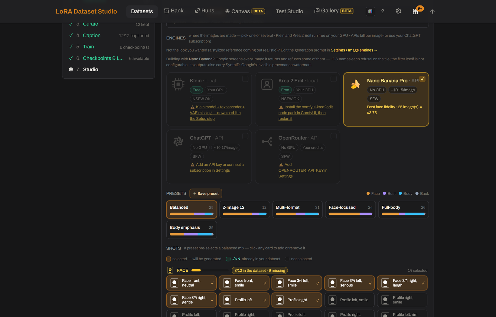

# How do I train a consistent character LoRA from one or a few photos?
<!-- description: Build a character LoRA dataset from one reference photo: generate about 25 varied shots locally, reject the ones where the face drifts, then train. -->

Start from one good reference photo, generate about 25 varied shots of the same person from it, reject the shots where the face drifts, then caption and train. In LoRA Dataset Studio (LDS), a **Character** dataset proposes a shot catalog for the subject (53 shots for a human, covering face, bust, body and back framings from several angles) and generates the missing shots locally with Klein or Krea 2 Edit, which restage the reference while preserving identity. Your own photos work too, on their own or mixed with generated shots.

## Set up the dataset

1. On the Datasets page, press **+ New dataset**, choose **Character**, set a trigger word and pick the target model. The model family decides the caption style and the minimum image count, and you can change it later.
2. Upload the reference photo. LDS head-crops it automatically; correct the framing in the crop editor if needed. Up to 3 extra angles can be added for multi-view consistency.
3. Pick the subject type: Human, Animal, Creature, Object, Other or Anime. Each has its own shot catalog (59 shots for an animal, 55 for an anime character) and its own identity wording. Anime protects the drawn design instead of turning the subject into a photograph.

## Generate the missing shots

**Generate variations** spreads the catalog across expression, angle, lighting, framing, outfit and background, with each prompt wrapped in an identity guard so the face stays the same person.

- **Klein** restages the reference with a general instruction-edit model.
- **Krea 2 Edit** is trained to keep an identity: from a single reference it holds the face, the body and permanent markings while changing angle, framing, light, background and clothes, with no character LoRA. It follows the framing of the selected shot card: 1:1 for face cards, 3:4 for bust, body and back.
- Both run on your own ComfyUI and appear only when it can run them. Local generation typically needs about 16 GB of NVIDIA VRAM.
- The optional [API image engines](../../bundled/api_engines/) plugin adds Gemini (Nano Banana), ChatGPT and OpenRouter, billed by each provider under its own content policy. With several engines ticked, **Split across engines** sends each shot to one engine.

Every generated tile keeps the exact prompt that made it, so one weak shot can be edited and regenerated without touching the rest.

## Keep the identity, drop the drift

- **Face similarity** (InsightFace) scores every image against the reference: green from 0.50 and orange from 0.45 by default. **Auto-triage** pre-marks images by that score and leaves your later manual decisions alone.
- The composition meter targets 12 face, 6 bust, 6 body and 1 back shot, about 25 images. **Body fidelity** mode (**Datasets → ⋯ More**) moves the target to 8, 8, 8 and 2, for when body shape and marks such as tattoos should bind to the trigger too.
- The [Camera angles](../../bundled/camera_angles/) plugin re-shoots a kept dataset image from other camera positions, set by direction, height and distance, with Qwen-Image-Edit and a Multiple-Angles LoRA on ComfyUI. The angle is written into the caption, and each new view arrives as a candidate to keep or reject.

## Start from your own photos

Import your photos by drag and drop. On a Character dataset they are cropped to the face on the way in, unless body fidelity is on. **Classify framing** sorts images without a shot type into face, bust, body and back with the local vision model. Then open [Coverage](../DATASET_GUIDE.md#9-coverage--what-your-set-never-showed), under the Composition bar: it reads the captions and names what the set never shows, such as profile views, daylight or a second outfit.

## Limits

- Face similarity is refused on Anime datasets, because InsightFace is trained on photographs and cannot read a drawn face.
- Face scoring needs the optional ML extras, which require Python 3.11 or 3.12.
- Generated shots are candidates, not guarantees. Reference quality still matters for likeness, so review each shot before keeping it.
- A full composition meter does not prove variety. Coverage reads caption words rather than pixels, does not parse negation and refuses to judge under five captions.
- An API provider can filter a request or return no image; LDS reports the provider's reason but cannot override it.

## Related

- [How many images do I need to train a LoRA?](how-many-images-to-train-a-lora.md)
- [Tags or natural language captions? Where does the trigger word go?](lora-captions-tags-or-natural-language.md)
- [How do I pick the best epoch or checkpoint?](pick-the-best-lora-checkpoint.md)
- [The character walkthrough, step by step](../guide/using-the-app.md#the-character-walkthrough-reference-photo--trained-lora)
