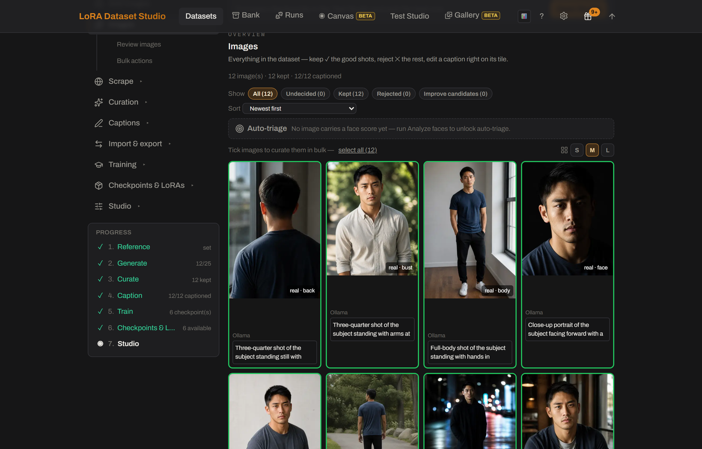

# How many images do I need to train a LoRA?
<!-- description: About 25 varied images make a balanced character LoRA. LDS minimums by family: 12 for Z-Image, 15 for Krea 2, FLUX.1 and FLUX.2 Klein, 20 for SDXL. -->

About 25 varied images make a balanced character LoRA, and 25 varied images beat 60 near-duplicates. LoRA Dataset Studio (LDS) sets a minimum per model family, 12 for Z-Image, 15 for Krea 2, FLUX.1 and FLUX.2 Klein and 20 for SDXL, with 20 to 30 as the comfort zone. Balance matters as much as the count: a set of close-ups gives a LoRA that falls apart on full-body prompts, because it has never seen the body.

## Minimums by model family

| Family | Minimum to launch | Recommended |
|---|---|---|
| Z-Image | 12 | 20 or more |
| SDXL | 20 | 30 or more |
| Krea 2 | 15 | 20 or more |
| FLUX.1 | 15 | 20 or more |
| FLUX.2 Klein | 15 | 20 or more |
| Anima, Qwen-Image 2.1 | 12, the default (no family-specific value) | 20 or more |

The minimum is a quality guard-rail. Below it, the readiness panel turns red and offers a **Continue anyway** checkbox; the launch is then recorded as "acknowledged not-ready" in its saved config. That path is meant for deliberate experiments, and the usual result is an overfit LoRA. A run with zero kept images is never allowed.

## Balance the framing

The Composition bar on the dataset page counts four shot types against a target of 12 face, 6 bust, 6 body and 1 back shot, about 25 images. **Body fidelity** mode moves the target to 8, 8, 8 and 2 when body shape and body marks should bind to the trigger too.

Only images with a shot type count. Images imported without the head-crop option have no shot type yet, and an unknown image counts for nothing in the bar. **Classify framing**, right under the bar in **Add images**, sorts them with the local vision model (Ollama or LM Studio); images it cannot read stay unknown. Cropping an image clears its shot type, so classify again after cropping.

## Vary everything except the subject

- Change location, lighting, outfit, pose, expression and camera angle. Whatever repeats gets baked into the LoRA: a background wall that appears in every image becomes part of the person.
- Reject near-duplicates. Two frames of the same shot teach nothing and overweight that look; the pre-flight check flags such pairs so you can reject one of each.
- Hold a quality floor: no motion blur, no heavy compression, a readable face. One bad image does more harm than one good image does good.
- A full Composition bar does not prove variety: twenty-five front-on studio portraits in one outfit fill it completely. The **Coverage** panel reads your captions and names what the set never shows, such as profile views, daylight or a second outfit.

## More images also means more steps

For a character LoRA, LDS sets the step count from the kept images: about 120 steps per image, rounded to the hundred and kept between 1,500 and 3,500.

| Kept images | Automatic steps |
|---|---|
| 12 | 1,500 |
| 15 | 1,800 |
| 20 | 2,400 |
| 25 | 3,000 |
| 30 and more | 3,500 (cap) |

Past about 30 images the step count stops growing. A high LoRA rank on a small set memorizes it, so raise the rank to 48 or 64 only for a hard identity and a bigger dataset. Concept and style datasets follow their own step policies; see [style and concept LoRAs](style-and-concept-loras.md).

## Limits

- The counts are guard-rails, not guarantees. Variety, captions and the checkpoint you pick decide the result.
- Classify framing needs a local vision model and the GPU; it waits for a running training instead of competing with it.
- Slider LoRAs, a beta feature, use a separate floor of 4 images with 12 recommended, because their images only serve as a denoising substrate.

## Related

- [How do I train a consistent character LoRA from one or a few photos?](character-lora-from-one-photo.md)
- [What steps, rank and learning rate should I use?](lora-steps-rank-learning-rate.md)
- [How many images, and which ones (dataset guide)](../DATASET_GUIDE.md#2-how-many-images-and-which-ones)
- [Coverage: what your set never showed](../DATASET_GUIDE.md#9-coverage--what-your-set-never-showed)
