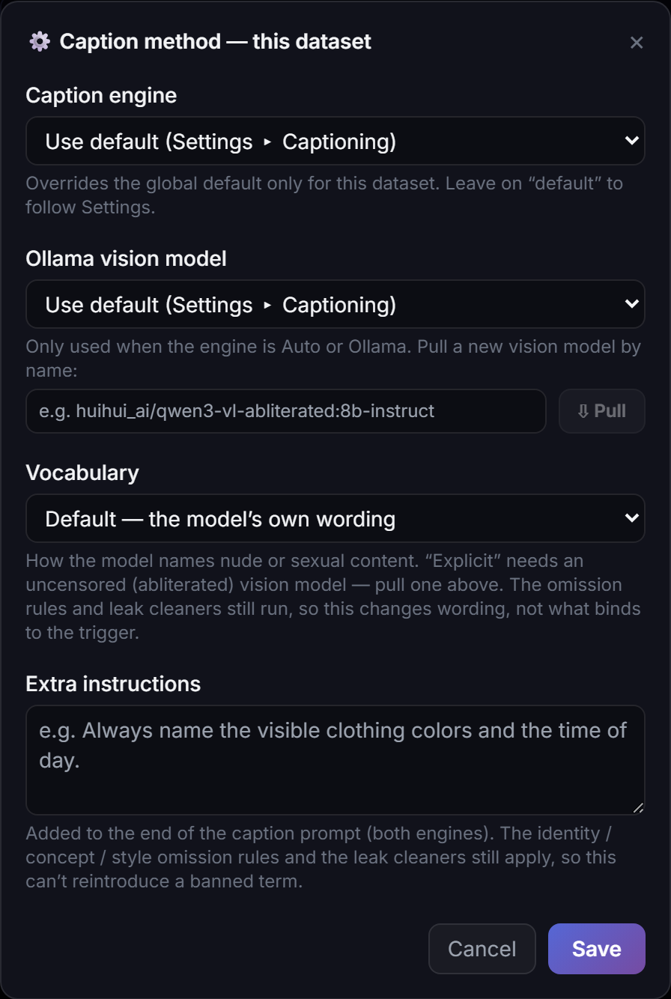

# Tags or natural language captions? Where does the trigger word go?
<!-- description: Caption in prose for Krea 2, FLUX, Z-Image and Qwen-Image 2.1, booru tags for SDXL, either for Anima. LDS puts the trigger word first. -->

Match the caption style to the model family: natural-language prose for Krea 2, FLUX.1, FLUX.2 Klein, Z-Image and Qwen-Image 2.1, booru tags for SDXL, and either for Anima. The trigger word goes at the start of every caption; LoRA Dataset Studio (LDS) adds it on export and in the caption files a training run reads, so you never type it. Describe what should stay changeable, such as place, light, outfit and pose, and leave out what should stick to the trigger.

## Caption style by family

| Family | Caption style |
|---|---|
| Z-Image, Krea 2, FLUX.1, FLUX.2 Klein, Qwen-Image 2.1 | Prose sentences |
| SDXL | Booru tags |
| Anima | Either; its model card documents both |

Before a launch, LDS samples up to 12 kept captions and decides by majority whether the set is prose or tags. A mismatch stops the launch with two ways out: re-caption in the right mode, or force the training. The check exists for a reason: a prose-captioned SDXL LoRA produces disjointed images. Anima is never flagged.

## Where the trigger word goes

On Character and Concept datasets, each exported caption reads `trigger, caption`. Write captions without the trigger and let LDS add it. Style datasets have no trigger: a style LoRA is always on, so its caption files contain the content description only. In the Test Studio, the **Trigger word** box, ticked by default, adds the trigger to your test prompts the same way.

## Describe everything except the subject

A LoRA learns what is constant across your images and not described in the captions. So never describe what the person is; describe everything else.

- Weak: `myTrigger, a woman with long blonde hair and blue eyes, smiling`. The caption already explains the appearance, so the LoRA learns almost nothing.
- Better: `myTrigger, sitting at a café table, warm afternoon light, denim jacket, looking at the camera`. Hair, face and skin stay unexplained and bind to the trigger.

**Appearance in captions**, in the options of the Captions panel, sets hair, makeup, facial hair and glasses to **Omit**, which binds the trait to the trigger, or **Describe**, which keeps it promptable. Hair is omitted by default. Face, eye colour, skin, age, gender and ethnicity always stay omitted. The identity-leak check flags any caption that describes an omitted trait; bring it to zero before training. Captions under about 8 words are too weak to isolate the identity, and identical captions teach nothing.

## Writing the captions in LDS

- **Engines:** JoyCaption, which runs through ai-toolkit, or a local vision model served by Ollama or LM Studio. The default `auto` setting tries JoyCaption first and lets the vision model cover the rest, so one batch can come back in two styles; pick one engine for the dataset to get a single voice.
- **Caption length:** Standard, Concise (one short sentence, about 20 to 30 words) or Detailed. These are loose targets: on 18 portrait photos with the default vision model, the medians were 24.5, 87.5 and 126 words.
- **Caption Lab** runs up to four caption configurations on one image side by side and writes nothing until you keep one.
- A running caption pass can be stopped at any point; every caption written so far is kept.
- **Another captioner:** use **Export ZIP**, caption the image and `.txt` pairs in any tool, then bring them back with **Import dataset (ZIP)** or **Import from folder**. Images are matched instead of duplicated, and a non-empty caption written in LDS is never overwritten.

## Limits

- Concept datasets can only be captioned in prose, so a concept on a booru-native SDXL checkpoint always trips the style check. Train concepts on a prose family, or force the launch and accept the quality loss.
- Dual captions, a long and a short caption per image, are off by default, work for local training only, and are not available on Krea 2 or Anima.
- Extra instructions cannot bring back an omitted trait; change its Appearance setting instead.

## Related

- [Which base model should I train my LoRA on?](which-base-model-for-a-lora.md)
- [Can I train a style or concept LoRA?](style-and-concept-loras.md)
- [Captions, the make-or-break step (dataset guide)](../DATASET_GUIDE.md#3-captions--the-make-or-break-step)
- [Caption your images in another tool](../guide/using-the-app.md#caption-your-images-in-another-tool)
