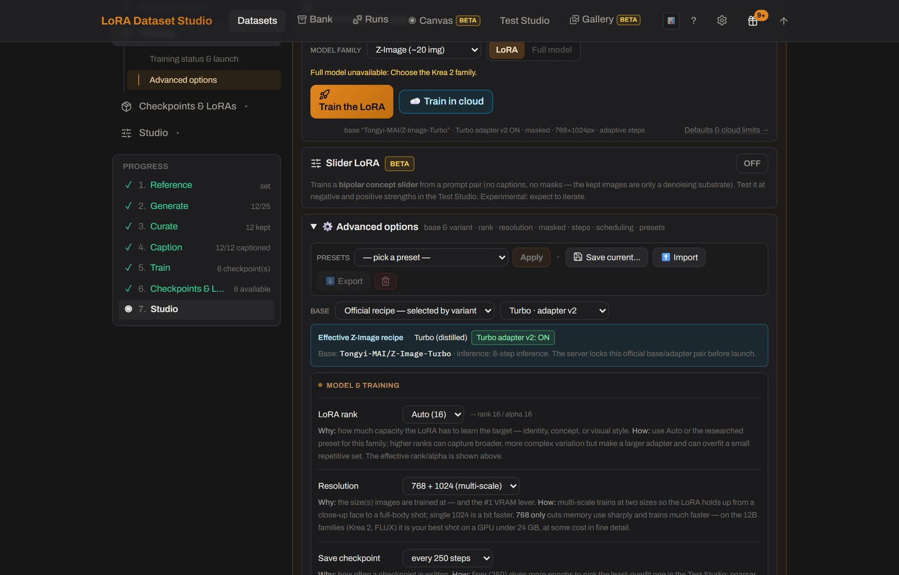

# What steps, rank and learning rate should I use?
<!-- description: LDS sets LoRA steps from your dataset: about 120 per image, 1,500 to 3,500, for a character. Default rank is 16 or 32, learning rate 1e-4. -->

Start from the guided recipe for your model family and let LoRA Dataset Studio (LDS) set the steps: about 120 per kept image for a character LoRA, kept between 1,500 and 3,500, because a fixed 3,000 overcooks small sets. The default rank is 16 or 32 depending on the family, and the learning rate is 1e-4 with the default `adamw8bit` optimizer. Raise the rank to 48 or 64 only for a hard identity and a bigger dataset; a high rank on 15 images memorizes them.

## Steps

The step count is automatic and follows the number of kept images.

| Dataset kind | Automatic steps |
|---|---|
| Character | About 120 per image, rounded to the hundred, from 1,500 to 3,500. 15 images give 1,800, 20 give 2,400, 25 give 3,000, 30 or more give 3,500. |
| Concept | 475 × √n, rounded to the hundred, from 2,000 to 12,000. 40 images give 3,000, 100 give 4,800, 400 give 9,500. |
| Style | 50 per image, rounded up to the hundred, clamped by family: 1,200 to 3,000 on FLUX.2 Klein, 2,000 to 3,000 on Krea 2 Raw, 1,000 to 2,000 on Krea 2 Turbo and Z-Image Turbo, 1,500 to 3,000 otherwise. |

For a character, the family changes how fast the target converges, not the target itself. Some built-in presets carry their own step rule: **Qwen-Image 2.1 · Character LoKr Multires** uses 50 steps per image, kept between 2,000 and 3,000. To force a number for one run, type it in the **Steps** box; leave the box empty to keep the automatic count.

Do not chase steps. A checkpoint is saved every 250 steps, and the best one is rarely the last: past the sweet spot come plastic skin, the same face angle in every image and prompts that stop working. Train the automatic count, then pick the earliest checkpoint that holds the identity.

## Rank and alpha

| Family | Default rank / alpha |
|---|---|
| Z-Image | 16 / 16 |
| SDXL | 32 / 16 |
| Krea 2 | 32 / 32 |
| FLUX.1 | 16 / 16 |
| FLUX.2 Klein | 16 / 16 |
| Anima | 32 / 32 |
| Qwen-Image 2.1 | 32 / 32 |

**LoRA rank** offers 8, 16, 24, 32, 48 and 64, and **Auto** keeps the family default. SDXL's alpha of half the rank is that family's half-strength convention. A Style dataset on FLUX.2 Klein uses its own researched recipe, rank 128 with alpha 64.

## Learning rate

Every optimizer that does not adapt its own rate runs at 1e-4 by default, and the default optimizer is `adamw8bit`. Prodigy sets its own rate (the `lr = 1` convention), so there is no base rate to change. Community presets may use another optimizer: **Krea 2 Raw · LoKr likeness** uses Automagic2 with an initial rate of 1e-4.

When you continue a run, the **Continue training** dialog can lower the rate for the extra steps to half or a tenth of the current one, for example from 1e-4 to 5e-5 or 1e-5. That choice is unavailable on Prodigy runs and when the full training state is resumed.

## Other defaults that matter

- **Resolution:** 768 + 1024 multi-scale, so the LoRA holds up from close-up to full body. **768 only (low VRAM)** is the main memory lever.
- **Masked training:** on for Character datasets. The background weighs 10% of the loss, so the identity binds to the person rather than the room. Concept and Style datasets turn it off.
- **Timestep weighting:** follows the family: sigmoid for Z-Image and FLUX.1, linear for Krea 2, weighted for FLUX.2 Klein and Anima.
- **Presets**, in **Advanced options**, apply a built-in recipe or save your own settings to reuse and share as JSON.

## Limits

- Continuing a run cannot change its rank, base model or optimizer; those are locked to the checkpoint.
- Community presets record what their source reported. They are starting points, not a guarantee for another person, image set or caption style.

## Related

- [How many images do I need to train a LoRA?](how-many-images-to-train-a-lora.md)
- [How do I pick the best epoch or checkpoint?](pick-the-best-lora-checkpoint.md)
- [Settings cheat-sheet (dataset guide)](../DATASET_GUIDE.md#4-settings-cheat-sheet)
- [Advanced training options in the settings reference](../guide/settings-reference.md#advanced-options-per-run)
