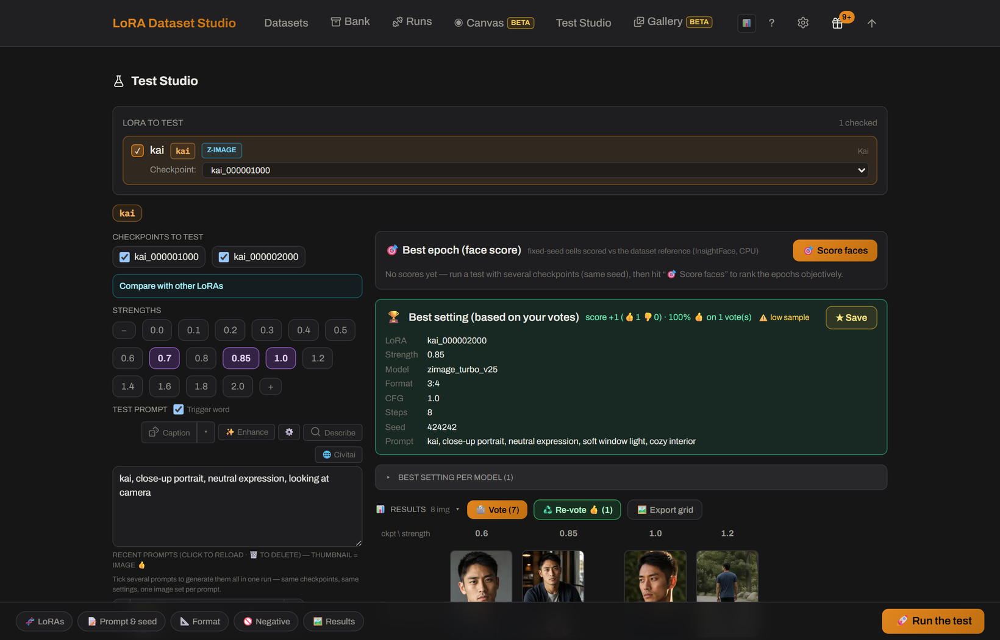

# How do I pick the best epoch or checkpoint?
<!-- description: Compare LoRA checkpoints at a fixed seed in the LDS Test Studio and keep the earliest one that holds the identity. The last checkpoint is rarely best. -->

Render the saved checkpoints with the same prompts and the same seed, then keep the earliest checkpoint that holds the identity: later checkpoints know the subject better but follow prompts worse. LoRA Dataset Studio (LDS) saves a checkpoint every 250 steps by default, and its Test Studio renders the checkpoints you pick at several strengths in one grid, so the images differ only by checkpoint and strength. Vote and rank the results, then save the winning settings.

## Run the comparison

1. Open the Test Studio from the dataset, where the LoRA comes preselected, or press **Test in Studio** next to a run on the **Runs** page.
2. Pick several checkpoints and strengths. Every cell of the grid uses the same seed and prompt.
3. Vote on the results. LDS ranks them from the votes with a Wilson ranking, and can also rank Character results by face similarity to the reference.
4. Star the winning settings; they are reused as the dataset's defaults.

The training previews help before you render anything: the dataset's lineage graph shows each saved epoch's preview with the same prompt and seed, and **Big previews** enlarges them into a grid.

## Signs a checkpoint went too far

Waxy or plastic skin, the same expression and angle whatever the prompt, and outfits from the dataset bleeding into new prompts. Where the sweet spot tends to land depends on the family:

| Family | Where to look first |
|---|---|
| Z-Image | Around the middle; overfitting shows in the last fifth |
| Krea 2 Turbo | Early to middle checkpoints |
| SDXL, FLUX.1 | Middle of the run |
| FLUX.2 Klein | Middle; previews use real CFG, so overfitting shows honestly |
| Krea 2 Raw | Last third; let the run finish |

## Test more than one prompt

Tick several saved prompts and one launch renders them all with the same checkpoints, settings and seed. Before you start, the panel estimates the time from your machine's recent pace, and asks once when the run goes past about an hour. The queue is serial: stop it at any point and everything already generated is kept. The **Civitai** browser adds prompts from Civitai's most-reacted images to the same batch; reading those prompts needs a free Civitai API key.

## Compare or blend several LoRAs

- **Compare** tests each LoRA on its own, one column per LoRA, across the strengths you picked.
- **Blend** loads them together in one image, each at its own weight. Start around 0.7 to 0.9, since two LoRAs at 1.0 usually fight. Blending two characters gives one hybrid person, not both side by side; character plus style and character plus concept are the reliable pairings.

## When no checkpoint is quite right

If the identity is almost there, **Continue training** restarts from any saved checkpoint, including an earlier and less-cooked one, without deleting the later saves. Add extra steps and, if needed, lower the learning rate for the continuation. The run can continue locally or in the cloud.

## Limits

- The Test Studio needs ComfyUI and the matching models for the family. FLUX.1, Anima and Qwen-Image 2.1 models are prepared in **Settings → Image engines → Trained image models**.
- One run uses one model family: a Krea 2 LoRA and an SDXL LoRA cannot be compared or blended together.
- Face ranking is not available on Anime datasets.
- If ComfyUI drops during a batch, the current cell is marked paused and later cells are not submitted until you choose what to resume.

## Related

- [What steps, rank and learning rate should I use?](lora-steps-rank-learning-rate.md)
- [After training: pick the right checkpoint (dataset guide)](../DATASET_GUIDE.md#6-after-training-pick-the-right-checkpoint)
- [Continue a run instead of starting over](../DATASET_GUIDE.md#continue-a-run-instead-of-starting-over)
- [Pick the best checkpoint (workflow guide)](../guide/workflow.md#8-pick-the-best-checkpoint)
