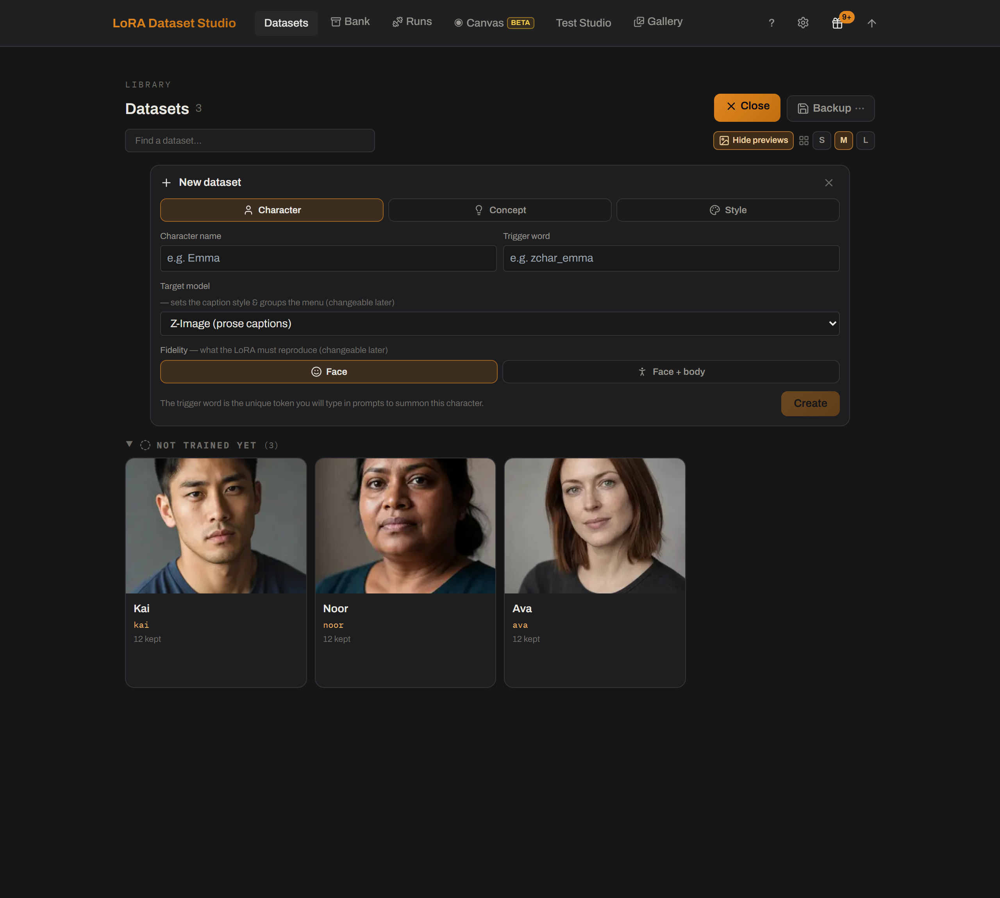

# Can I train a style or concept LoRA?
<!-- description: Yes. LDS has Style and Concept dataset workflows, with prose-only concept captions, 475 × √n concept steps from 2,000 to 12,000 and face masking. -->

Yes. LoRA Dataset Studio (LDS) has separate **Style** and **Concept** dataset kinds, each with its own captioning rules, masks, readiness checks and step policy. Concept captions must be prose rather than booru tags, concept steps grow more slowly with the image count (about 475 × √n, from 2,000 to 12,000), and an optional face mask keeps the people in your photos out of a concept LoRA.

## Concept LoRAs

A concept is an object or an action rather than a person. Pick **Concept** when you create the dataset and describe the concept in the required field, so the captioner knows what to leave out.

- There is no reference photo. Images come from import, the built-in scraper or an Image Bank, and imports keep the full frame.
- Captions invert the character rule: they describe everything except the concept, so the concept is what binds to the trigger. The leak check flags captions that describe it anyway.
- Person masking is off, because a person mask would erase the thing you are teaching.
- Concept captions are only produced as prose. Train concepts on a prose family (Z-Image, Krea 2, FLUX.1, FLUX.2 Klein or Anima); on a booru-native SDXL checkpoint the caption-style check always stops the launch unless you force it.
- Steps follow 475 × √n, rounded to the hundred and kept between 2,000 and 12,000: 40 images give 3,000 steps, 100 give 4,800 and 400 give 9,500. A bigger set sees each image fewer times, so the LoRA generalizes the concept instead of memorizing shots.

## Keep faces out of a concept

When every image shows people, a concept LoRA also learns their faces, and it then pulls against any character LoRA stacked with it. **Mask faces**, in the advanced training options of a Concept dataset, detects faces and weighs them down in the training loss. Your images are not touched: nothing is blurred, because a blurred face is exactly what the model would learn to draw.

- Two settings in **Settings → Training** tune it: head coverage, 2.0 times the face box by default (1.0 to 3.0), and the loss weight kept on faces, 0.1 by default (0.05 to 1.0, never zero).
- It needs InsightFace face detection, an optional install of about 400 MB offered from the option itself.
- Preview the mask on your shots first. A partly masked set is the bad case: the unmasked faces become the only ones the LoRA still learns.
- Variety beats masking. A concept shown by ten different people already dilutes identity; with two, no mask fully compensates.
- If the concept lives on the face, such as an expression or a gaze, masking the head can erase it. LDS warns when your description suggests this but does not stop you.

## Style LoRAs

- A Style dataset has no trigger word: the style applies whenever the LoRA is loaded.
- Captions describe the content only, never the rendering, so the look stays unnamed and binds to the LoRA. An uncaptioned image makes the launch ask for confirmation, and captions that are all identical, or contain only the internal run id, are flagged. Exported caption files contain no trigger.
- Person masks are off, because a style is learned across the whole frame.
- Steps follow 50 per image, rounded up to the hundred and clamped by family: 1,200 to 3,000 on FLUX.2 Klein, 2,000 to 3,000 on Krea 2 Raw, 1,000 to 2,000 on Krea 2 Turbo and Z-Image Turbo, 1,500 to 3,000 on the others.
- Style LoRAs want large sets, often hundreds of images.

## Limits

- Nobody has published a before-and-after of a concept LoRA trained with and without face masking; the option gives you the lever, not a promise.
- The Coverage panel judges a style dataset on lighting, setting and camera view only, and drops the expression axis for a concept.
- A concept on SDXL can only be forced past the caption-style check, at a quality cost.

## Related

- [Tags or natural language captions? Where does the trigger word go?](lora-captions-tags-or-natural-language.md)
- [What steps, rank and learning rate should I use?](lora-steps-rank-learning-rate.md)
- [Concept LoRAs: keeping faces out (dataset guide)](../DATASET_GUIDE.md#8-concept-loras-keeping-faces-out)
- [Concept datasets](../guide/using-the-app.md#concept-datasets-an-object-or-action-not-a-person)
