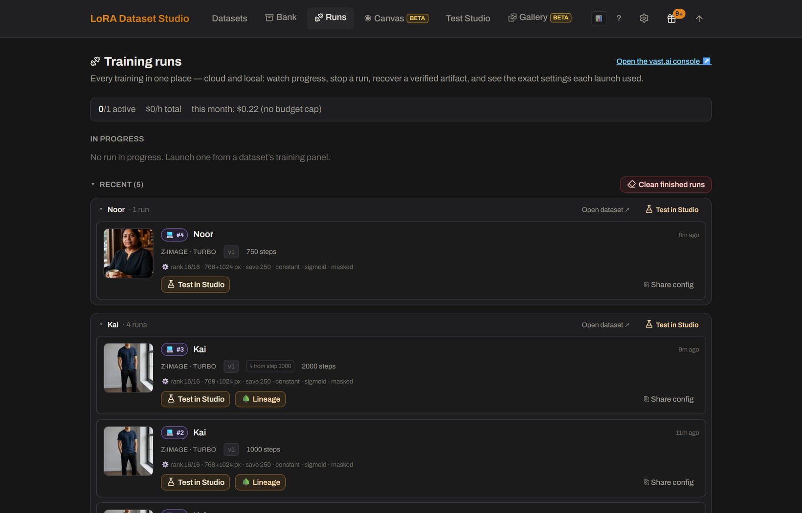

# Which LoRA trainer should I use? Do I need the command line?
<!-- description: LDS trains LoRAs with ai-toolkit and writes its config for you, so runs start from the browser. Exported ZIPs also feed kohya_ss or OneTrainer. -->

LoRA Dataset Studio (LDS) trains with [ai-toolkit](https://github.com/ostris/ai-toolkit) and writes its training config for you: once ai-toolkit is installed and set in **Settings → Local tools**, you pick a recipe and start the run from the browser, with the queue and logs on the **Runs** page. Datasets also export as standard ZIPs of images with same-name `.txt` captions, so the same set can feed kohya_ss, OneTrainer or another trainer. The command line is needed once, to install ai-toolkit, which LDS does not install for you.

## What LDS does with ai-toolkit

ai-toolkit is the training engine. LDS runs it as a command-line process, from its own folder and its own Python environment (the one with PyTorch), and starts and stops it for you. The web interface that ships inside ai-toolkit is unrelated: LDS never launches it or reads it.

From the dataset's training panel, LDS:

- builds the ai-toolkit config from the family recipe, the dataset kind and your **Advanced options**;
- checks images, captions, duplicates, free disk, VRAM, the base model and compatibility before the launch, then again when a queued run actually starts;
- queues local runs and lists every run, local or cloud, on the **Runs** page with progress, logs, samples, stop, retry, continue and download actions, plus a paste-safe **Share config** summary.

## Connect ai-toolkit once

1. Install ai-toolkit in its own folder. The [getting started guide](../guide/getting-started.md) recommends Python 3.11, or ai-toolkit's own installer, `python -m manager install`, which provisions a supported Python and the CUDA build of PyTorch that matches your driver. A plain `pip install torch` on Windows installs a CPU-only build, and training then runs on the CPU for hours without an error.
2. In **Settings → Local tools → ai-toolkit**, set the folder that contains `run.py`. Fill **Python interpreter** only when there is no `venv` or `.venv` folder next to it, for example with conda, uv or a portable Python.
3. Press **Test**. It checks that the interpreter can import PyTorch; a passing test unlocks training and JoyCaption captioning.

## Use another trainer

**Export ZIP** writes one `10_<trigger>` folder of PNG images with same-name `.txt` captions. Captions carry the trigger word, and a reference photo, when the dataset has one, is included as an extra image captioned with the trigger alone; Style exports contain content captions only, with no trigger and no reference. The `10_` prefix follows the kohya repeat-count folder convention, and ai-toolkit ignores the folder name. **Write .txt files** puts the same kohya-style captions next to each kept image in the dataset folder instead.

For an architecture LDS does not support, or for experimental config keys, use ai-toolkit directly with the exported set.

## Limits

- Local training needs an NVIDIA GPU with enough memory; see [how much VRAM a LoRA needs](lora-training-vram.md).
- LDS drives ai-toolkit and no other trainer.
- The Docker images and the RunPod image do not include local ai-toolkit training: connect an ai-toolkit on the host, or train in the cloud.
- Without a suitable GPU, the [Cloud training](../../bundled/cloud_training/) plugin rents one per run on vast.ai with your own API key, for Z-Image, Krea 2, FLUX.2 Klein and Qwen-Image 2.1. SDXL, FLUX.1 and Anima train locally only.
- If ai-toolkit uses conda, uv or the system Python and is not detected, fill the Python interpreter field; see [ai-toolkit isn't detected](../guide/troubleshooting.md#ai-toolkit-isnt-detected-conda--uv--no-venv).

## Related

- [What steps, rank and learning rate should I use?](lora-steps-rank-learning-rate.md)
- [How much VRAM do I need to train a LoRA?](lora-training-vram.md)
- [Train, guided and advanced (workflow guide)](../guide/workflow.md#6-train--guided-advanced-when-you-need-it)
- [ai-toolkit settings](../guide/settings-reference.md#ai-toolkit)
